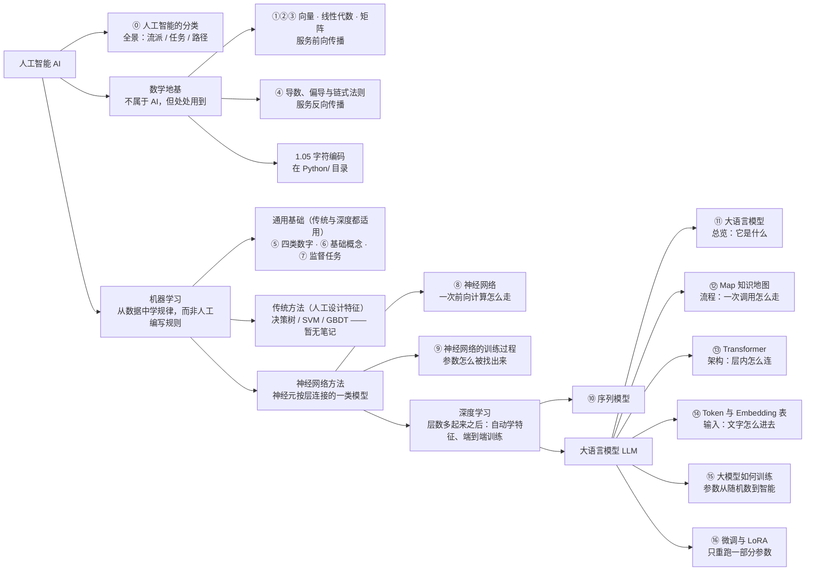

#AI #index

# AI 知识索引

> Library/AI 的目录页：读什么、按什么顺序读、某个词在哪一篇讲透。**入口就是这里。**

## 从这里开始

**这一页是目录，不是内容。** 全库唯一的「串讲」是第 ⑫ 篇 [[AI/Map|AI 知识地图]]——它拿一次真实的模型调用把所有知识点串成一条线。但它**不是入口**：它默认你已经读过 ①③⑤⑧⑪，直接从那里开始会处处卡壳。

两条路，按你的目的选：

| 你的目的 | 怎么走 |
|---|---|
| **想搞懂模型是怎么回事**（系统学） | 按下面的顺序表从 ⓪ 走到 ⑰。数学卡住时回 [[数学地基/Index\|数学地基]] |
| **想做 Agent 应用，先够用**（按需查） | ⓪ → ⑪ → ⑫ → ⑭ → ⑰。这五篇覆盖了调 API 时天天遇到的东西：token 计费、上下文窗口、采样策略、三阶段训练解释模型行为、检索增强 |

**这个库目前只覆盖到「模型本身」。** Agent、Tool Calling、MCP、Skill、子代理这些应用层内容还是空白，进度见 [[Agents 底层逻辑课程整理进度]]。

写新笔记或改旧笔记之前，先读 [[写作规范]]。

---

## 阅读顺序

| # | 笔记 | 讲什么 | 前置 | 备注 |
|---|------|-------|------|------|
| ⓪ | [[人工智能的分类]] | 三套分法：哲学流派、任务版图、实现路径；附岗位分层 | 无 | 零前置、不含公式，先建坐标系 |
| ① | [[向量与点积]] | AI 的通用语言：一排数字与相似度 | 无 | 数学地基，服务前向传播 |
| ② | [[线性代数入门]] | 什么是线性、矩阵从哪来、符号怎么读 | ① | **零基础入口**：看不懂 ∑ 和下标就从这篇开始 |
| ③ | [[矩阵与线性变换]] | 一次算完一整层的语言 | ①② | 数学地基，服务前向传播 |
| ④ | [[导数、偏导与链式法则]] | 反向传播用到的全部微积分，附自测题 | ① | 数学地基，服务反向传播；只需初中代数 |
| ⑤ | [[模型里的四类数字]] | 超参数 / 参数 / 特征 / 激活值的分界 | ①③ | **纠错型**：不讲新知识，读后面任何一篇卡住都可回查 |
| ⑥ | [[机器学习基础概念]] | 「学习」的定义、打分与陷阱 | 无 | 急于上手可从这篇开始，公式看不懂再回 ①~④ |
| ⑦ | [[监督学习任务]] | 有标准答案时能做的事 | ⑥ | |
| ⑧ | [[神经网络]] | 一次前向计算怎么走：神经元、层、激活函数、参数量 | ①②③⑤⑥ | 与 ⑨ 是一对 |
| ⑨ | [[神经网络的训练过程]] | 这些参数怎么被找出来：前向 → 损失 → 反向 → 更新 | ④⑥⑧ | 与 ⑧ 是一对 |
| ⑩ | [[序列模型]] | 处理语音和文本：RNN、CTC、Attention | ⑧ | |
| ⑪ | [[大语言模型]] | LLM 全貌：输出概率分布、自监督预训练、三阶段 | ①⑥⑧ | 总览之一：讲**它是什么** |
| ⑫ | [[AI/Map\|Map 知识地图]] | 一次调用从输入到输出的每一步，形状与运算 | ①③⑤⑧⑪ | 总览之二：讲**一次调用怎么走**。**不是入口** |
| ⑬ | [[Transformer]] | 注意力机制本身 + 一层由哪些部件组成 | ①③⑤⑩⑫ | 架构 |
| ⑭ | [[Token 与 Embedding 表]] | 文字怎么进模型：字节 → token → 向量 | ①、[[1.05 字符编码]] | 输入 |
| ⑮ | [[大模型如何训练]] | ⑨ 那套循环放到几十亿参数上：猜下一个词 | ⑥⑨⑬⑭ | 训练 |
| ⑯ | [[微调与 LoRA]] | 调的是哪批数字、LoRA 怎么省、什么时候别微调 | ⑪⑮ | 微调 |
| ⑰ | [[RAG]] | 检索 + 生成的工程合体 | ⑫⑬⑭、[[Vector Database]] | 工程应用 |

三条读法提示：

- **⑬⑭⑮ 顺序可以互换**（架构、输入、训练三个侧面），但都依赖 ①~⑩。先读完 ⑪⑫ 这两篇总览，再看它们各自在补哪一格。
- **⑫ 和 ⑬ 都会出现 Q/K/V**，分工是：⑫ 沿一次调用的时间线走（每步的形状与所用参数），⑬ 沿机制本身的逻辑走（注意力为什么长这样、每个部件解决什么问题）。
- **①②③④ 四篇数学地基都在 [[数学地基/Index|数学地基/]] 目录**，那里有更细的分工说明与缺口清单。

---

## 知识树：这些笔记之间是什么关系

**箭头 = 真包含关系**：机器学习 ⊋ 神经网络方法 ⊋ 深度学习 ⊋ 大语言模型，层层嵌套的子集，不是并列的几个门类。

**工程应用横跨各层**，不是上面任何一层的子集——它是消费方，拿别人训好的模型干活，本身不涉及「学规律」：⑰ [[RAG]]、[[Embedding Service]]（Database/）、[[Vector Database]]（Database/）。

跨文件夹的笔记物理上不在 `AI/` 里，但属于这棵树，已双链打通：数学地基四篇在 [[数学地基/Index|数学地基/]]，字符编码在 `Python/`，Embedding Service 与 Vector Database 在 `Database/`。

### 三条容易混淆的边界

**其一**，深度学习只是机器学习的一个分支，不能当机器学习的同义词——「传统方法」那一支不是历史遗迹，在结构化数据上仍是首选。

**其二**，**深度学习 ≠ 神经网络**。神经网络是模型类（只要神经元按层连接就算，含单层感知机、单隐藏层的浅层网络）；深度学习特指层数多的情形，外加端到端训练、表示学习这套方法论，以及让深层网络训得动的配套技术（反向传播的工程实现、ReLU、残差连接、批归一化、Dropout）。层数没有严格门槛，惯例上两层以上隐藏层算「深」。反向也不成立：深度森林 gcForest 是非神经网络的深度模型，说明「深度」指的是层次化表示这个思想，神经网络只是它最成功的载体。

**其三**，工程应用不参与上面的包含关系。RAG 用的是别人训好的模型，它是消费方。

---

## 概念速查：这个词在哪篇讲透了

> 数学概念（向量、矩阵、导数、梯度……）的速查表在 [[数学地基/Index|数学地基索引]]，下表只列 AI 侧。

| 概念 | 所在笔记 |
|------|---------|
| 符号主义、连接主义、行为主义、知识工程、演化计算（遗传算法）、NLP / 语音 / CV 任务版图、ASR/TTS/OCR、AI 岗位三层分工 | [[人工智能的分类]] |
| 超参数 vs 参数 vs 输入特征 vs 激活值、config.json / safetensors、W_q 与 Q 的区别 | [[模型里的四类数字]] |
| 损失函数 / 代价函数 / 目标函数、交叉熵、极大似然、梯度下降、学习率、过拟合、i.i.d.、T/E/P 定义、四种学习方式（监督 / 自监督 / 无监督 / 强化） | [[机器学习基础概念]] |
| 回归、分类、搜索、推荐、PageRank | [[监督学习任务]] |
| 神经元、权重、偏置、激活函数（正式名：非线性函数 nonlinearity）、ReLU、Sigmoid、Softmax、GELU/SiLU、dead ReLU、隐藏层、层、输出层、折点 x=−b/w、n+1 段、万能逼近定理、深度 vs 宽度、层记号 a^(l)、总参数量公式 | [[神经网络]] |
| 前向传播、反向传播、梯度、链式法则、梯度消失、SGD / Full Batch / Mini-Batch、batch size、step、epoch、Adam、自动微分、训练 vs 推理 | [[神经网络的训练过程]] |
| RNN、隐状态、CTC | [[序列模型]] |
| 自回归（定义）、temperature、自监督、base model、指令微调 SFT、RLHF / DPO、幻觉 | [[大语言模型]] |
| 数据形状、Q/K/V、W_q/W_k/W_v/W_o、logits、采样策略（greedy / top-k / top-p）、因果掩码、KV 缓存、prefill / decode、O(n²)、自回归循环（机械过程）、226 个矩阵、张量、safetensors 格式 | [[AI/Map\|Map]] |
| 注意力（机制定义：权重是激活值）、自注意力、交叉注意力、softmax 与饱和、√dₖ、因果掩码、多头与 W_o、子空间投影与头的分化、induction head、GQA / MQA、位置编码 / RoPE、层 vs 子层、前馈子层（FFN = MLP、SwiGLU）、残差连接、层归一化 / RMSNorm、编码器-解码器、BERT/GPT/T5 | [[Transformer]] |
| token、分词器、词表、字节兜底、embedding 表、按 token 计费、LLaMA | [[Token 与 Embedding 表]] |
| 猜下一个词、题库自造、参数（7B / 70B） | [[大模型如何训练]] |
| 全量微调、PEFT、LoRA、ΔW=BA、rank / 秩、缩放因子 α、adapter、QLoRA、冻结 freeze、优化器状态、对话模板 chat template、灾难性遗忘、微调 vs RAG 的分工 | [[微调与 LoRA]] |
| 检索增强生成、chunk 与切分策略、chunk_size / overlap、top-k、稠密 / 稀疏 / 混合检索、BM25 与 TF-IDF、重排序与 Cross-Encoder、HyDE、Prompt Caching、RAG vs 长上下文 vs Agentic Search、CAG、Recall@K / MRR / NDCG / Faithfulness | [[RAG]] |
| Unicode、UTF-8、码点、乱码 | [[1.05 字符编码]] |
| 向量检索、embedding 服务 | [[Embedding Service]]、[[Vector Database]] |

**没有主讲、只有散点的概念**（想查会扑空，已列入下方缺口）：

| 概念 | 目前散落在 |
|---|---|
| **上下文窗口** | [[Token 与 Embedding 表]]（按 token 算长度）、[[大语言模型]]（每次调用重算整段）、[[AI/Map\|Map]]（O(n²) 与长度上限）、[[Transformer]]（RoPE 撑到 128K） |

---

## 这个库还没有的

- **概率与对数**（log、指数、概率分布、极大似然、softmax 的数学地基）—— [[机器学习基础概念]] 第 5 节已经在用这些，地基却是空的。**当前最该补的一篇**，位置在 ④ 之后
- **上下文窗口** —— 见上，四篇各有散点，缺一处把它讲透的地方
- **传统机器学习方法**（决策树、SVM、GBDT）—— 知识树里的空分支
- **RLHF / DPO 的内部细节**（奖励模型怎么训、PPO 与 DPO 的差别）—— 目前只有一句话
- **线性注意力与状态空间模型**（Mamba、RWKV、RetNet）—— 全库只在 [[Transformer]] 第 11 节有一句提及
- **应用层整片空白** —— Agent、Tool Calling、MCP、Skill、子代理，见 [[Agents 底层逻辑课程整理进度]]

---

## 维护说明

- **写之前先读 [[写作规范]]**，改完照它文末的自查清单过一遍
- 新增笔记时只需维护**两处**：上面的「阅读顺序」表插一行、「概念速查」补一行；知识树只在新增的是一个**新分类**时才动
- 引用别篇的节号时，改完要回查反链：`grep -rn "\[\[被改的篇名\]\] 第" .`
- [[人工智能的分类]] 编号为 ⓪ 而非插进 ①~⑰ 重排：它是零前置的总览型笔记，后续新增同类照此处理
- 文件名不加序号前缀（区别于 Python / HTTP 系列），避免破坏既有双链；顺序以本页为准
- 数学地基四篇 2026-08-29 迁往 `Library/数学地基/`（见 [[数学地基/Index|数学地基索引]]）。全库对它们的引用都是无路径的 `[[名称]]` 形式，按文件名解析，迁移未影响任何链接；本索引继续把它们挂在知识树上，编号 ①~④ 不变
- 编号历史：2026-08-29 两次插入并重排——先加 [[神经网络的训练过程]]，再加 [[导数、偏导与链式法则]]（现为 ④，其后整体顺延）
- 2026-09-08 全库补齐并统一了定位块格式（`这篇讲 / 这篇不讲 / 前置` 三行），18/21 篇有，其余 3 篇是索引页与进度文档，按 [[写作规范]] 第 1 条豁免
- 2026-09-08 本页从四份并行目录（学习顺序 / 知识树 / 各篇定位表 / 概念速查，228 行里 194 行是同一批信息的四次复述）合并为两份：**阅读顺序表**给新读者，**概念速查**给回头查的人；知识树只保留包含关系骨架，各篇的关键词一律只在概念速查里出现一次
