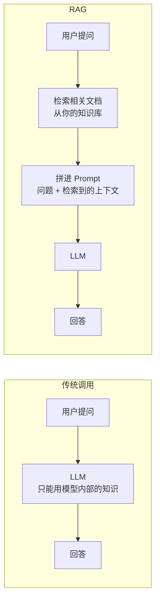
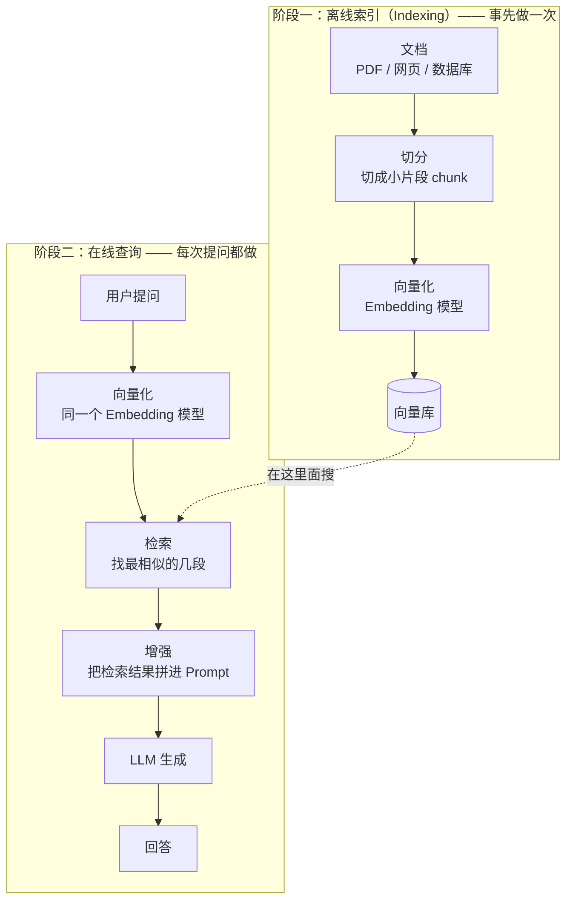

#AI #LLM #RAG

# RAG：检索增强生成

> [!note] 定位
> **这篇讲**：怎么让模型回答它没学过的东西——先从你的知识库里捞出相关内容，再让模型基于这些内容作答。包括它解决什么问题、什么时候**不该**用它、四个组件怎么选、失灵时怎么排查。
> **这篇不讲**：向量和相似度的数学（去 [[向量与数量积]]）；向量数据库怎么选型和部署（去 [[Vector Database]]）；微调（去 [[微调与 LoRA]]）；模型本身怎么工作（去 [[大语言模型]]）。
> **前置**：[[大语言模型]]（知道模型为什么会有知识截止和幻觉）、[[向量与数量积]]（知道「数量积（俗称点积）衡量像不像」）。

## TL;DR

- **RAG（Retrieval-Augmented Generation，检索增强生成）= 先检索、再生成**：把用户问题拿去知识库里搜一遍，把搜到的内容塞进 Prompt，让模型基于它作答
- **它解决四件事**：模型的知识截止、幻觉、访问不到私有数据、微调成本高
- **基本流程**：`用户提问 → 向量化 → 相似度检索 → 拼进 Prompt → LLM 生成`
- **四个组件**：Embedding 模型、切分策略（Chunking）、向量数据库、检索器（Retriever）
- **它不再是唯一选择**。知识库小而静态用**长上下文**更准，探索型任务用 **Agentic Search** 更强——第 3 节有决策表。先读那一节再决定要不要往下投入
- **换 embedding 模型 = 整库重灌**，因为两个模型的向量坐标系不通（[[向量与数量积]] 第 6 节）
- **「放弃 RAG」的准确含义**不是不用检索，而是检索从「一次性预处理」变成「模型可调用的工具」

---

## 1. 它解决什么问题

大语言模型有四个固有局限（前三个的成因见 [[大语言模型]]）：

| 局限 | 具体表现 |
|------|------|
| **知识截止**（knowledge cutoff） | 模型只知道训练数据截止日期之前的信息 |
| **幻觉**（hallucination） | 模型会编造不存在的事实。成因是它的训练目标里只有「下一个词的概率高」，没有「说真话」这一项 |
| **访问不到私有数据** | 企业内部文档、你自己的笔记，模型压根没见过 |
| **微调成本高** | 为特定领域重新训练要数据、要算力，且知识一更新就得再来一遍（见 [[微调与 LoRA]]） |

RAG 的做法是**在推理时动态注入外部知识**，不动模型参数：



关键在于**模型本身没有任何变化**——参数是冻结的（见 [[神经网络的训练过程]] 第 8 节）。变的只是你喂给它的 Prompt 里多了一段材料。

---

## 2. 基本架构：两个阶段



**阶段一：离线索引**，把知识库变成可检索的形式。加载文档 → 切分成 chunk → 每个 chunk 转成一个向量 → 存进向量库。这一步事先做一次，文档更新时再做。

**阶段二：在线查询**，每次提问都走一遍。把问题转成向量 → 在向量库里找最相似的几个 chunk → 把它们拼进 Prompt → 让模型基于这些内容回答。

> **两个阶段必须用同一个 embedding 模型。** 不同模型的向量坐标系不通，用 A 模型灌的库配 B 模型的查询向量，算出来的相似度没有意义（[[向量与数量积]] 第 6 节）。

**chunk**（片段）是 RAG 里的基本单位：一段被切下来、单独向量化、单独检索的文本。切多大是这套系统里最影响效果的一个旋钮，见第 4 节。

---

## 3. 先决定：要不要用 RAG

**这一节应该在动手之前读。** 经典 RAG 已经不是唯一选择，选错路线会白做很多工。

| 维度 | 经典 RAG | 长上下文 Long Context | Agentic Search | 混合 Hybrid |
|------|---------|--------------|----------------|--------|
| **知识规模** | TB 级可行 | 受上下文窗口限制（约 100 万 token） | 中等，取决于工具效率 | 分级处理 |
| **准确率** | 取决于检索质量 | 高（全量可见，没有检索误差） | 高（可迭代改进） | 高 |
| **成本** | 低（只塞 top-k） | 高（即使有缓存） | 中（多轮调用） | 中 |
| **延迟** | 低 | 中到高 | 高（多轮） | 中 |
| **可追溯** | 强（来源明确） | 弱 | 中（工具调用链可见） | 强 |
| **多跳推理** | 弱 | 中 | 强 | 强 |
| **适用场景** | 大语料、有合规要求 | 中等知识库、复杂推理 | 探索型任务、代码 | 生产级复杂应用 |

**top-k** 指检索时取相似度最高的 k 个 chunk，k 通常是 3~10。

### 怎么选

| 你的情况 | 选哪条路线 |
|---|---|
| 知识库 < 50 万 token，且很少变动 | **长上下文 + Prompt Caching** |
| 知识库 TB 级，或有强合规、可追溯要求 | **经典 RAG + 重排序** |
| 探索型任务、多跳推理（如代码助手） | **Agentic Search** |
| 生产级问答系统 | **混合**：粗粒度 RAG 召回大段落 → 长上下文装入候选 → Agent 在其中精细搜索 |

**Prompt Caching**（提示词缓存）是服务商提供的能力：把 Prompt 里不变的前缀预先算好缓存起来，后续请求命中缓存时只算增量部分，费用和延迟都大幅下降。它是「长上下文」这条路线能成立的成本前提。

### 顺带：RAG 还是微调

两者常被拿来比较，但解决的不是同一类问题：

| | RAG | 微调 |
|---|---|---|
| 注入的是 | **知识**（事实、文档内容） | **行为**（输出格式、语气、特定任务的做法） |
| 知识更新 | 改知识库即可，实时 | 要重新训练 |
| 可追溯 | 强，能标出处 | 弱，知识化进了参数 |

**两者不互斥**，生产上常常一起用：微调调行为，RAG 注知识。完整对比见 [[微调与 LoRA]]。

---

## 4. 四个核心组件

### 4.1 Embedding 模型

把文本转成向量，使语义相近的文本在向量空间里距离更近。它的原理见 [[Token 与 Embedding 表]]，作为服务部署见 [[Embedding Service]]。

常用选择：OpenAI 的 `text-embedding-3-small` / `-large`；开源的 **BGE**（北京智源）、**E5**（微软）、**GTE**（阿里）、**Jina Embeddings**。

选型看四点：向量维度（影响存储和计算成本）、支持的最大 token 数（决定单个 chunk 能多长）、多语言支持、在你自己领域上的实测表现。

> **换模型的代价**：一旦换掉，**整个向量库必须重新灌一遍**。理由见第 2 节的提醒。所以选型要在灌库之前定下来。

### 4.2 切分策略（Chunking）

把长文档切成 chunk，是**影响 RAG 质量最大的一个环节**。

| 策略 | 做法 | 适用 |
|------|------|----------|
| **固定长度** | 按固定字符数或 token 数切 | 简单快，适合结构化文档 |
| **按句子** | 在句子边界切 | 保持语义完整 |
| **按段落** | 在段落边界切 | 适合文章类内容 |
| **递归切分** | 先按大单位（段落）切，超长再按小单位（句子）切 | 通用性好，LangChain 默认 |
| **语义切分** | 按前后文语义相似度动态决定切点 | 质量最高，计算成本也最高 |

两个关键参数：

- `chunk_size`：每个片段多大。太大则一个 chunk 里混了多个主题，检索不准；太小则单个 chunk 信息不全，模型看不懂
- `chunk_overlap`：相邻片段重叠多少，避免一句话正好被切断

```python
from langchain.text_splitter import RecursiveCharacterTextSplitter

splitter = RecursiveCharacterTextSplitter(
    chunk_size=1000,
    chunk_overlap=200,
    separators=["\n\n", "\n", "。", ".", " ", ""]
)
chunks = splitter.split_text(document)
```

### 4.3 向量数据库

专门存向量、并支持高效相似度搜索的数据库。原理与选型详见 [[Vector Database]]，这里只列常见选择：

| 数据库 | 特点 |
|--------|------|
| **Pinecone** | 全托管，开箱即用，适合快速上手 |
| **Weaviate** | 开源，支持混合检索 |
| **Milvus** | 开源，高性能，适合大规模 |
| **Chroma** | 轻量，适合本地开发和原型 |
| **Qdrant** | 开源，Rust 编写，性能好 |
| **pgvector** | PostgreSQL 扩展，已有 PG 基础设施时首选 |

### 4.4 检索器（Retriever）

决定「怎么找」。三种方式：

| 方式 | 怎么算 | 强项 | 会失灵的地方 |
|---|---|---|---|
| **稠密检索**<br/>Dense Retrieval | 用 embedding 向量算相似度（余弦相似度、数量积、欧氏距离） | 同义改写也能召回——「怎么退货」能召回「退换货流程」 | 专有名词、编号、代号不敏感 |
| **稀疏检索**<br/>Sparse Retrieval | **BM25** / **TF-IDF**：按关键词的出现频率和稀有度打分，**完全不看语义** | 专有名词、产品型号、错误码精确匹配 | 换个说法就召不回 |
| **混合检索**<br/>Hybrid Retrieval | 两者都跑，分数加权合并 | 兼顾语义和字面 | 要调两套参数 |

**TF-IDF** 的思路是：一个词在这篇文档里出现得越多、在整个语料库里出现得越少，它就越能代表这篇文档（「的」到处都是所以不算数，「pgvector」很罕见所以很关键）。**BM25** 是它的改进版，加了文档长度归一化，是搜索引擎的经典基线。

**生产环境通常用混合检索**——语义和字面各能救对方一次。

---

## 5. 失灵时怎么排查

### 检索质量差（召回的内容不对）

| 可能原因 | 怎么办 |
|------|----------|
| chunk 太大或太小 | 调 `chunk_size`，实测不同值 |
| Embedding 模型不合适 | 换模型，或换领域特定的模型 |
| 查询和文档表述差异大 | 用查询改写（见附录 A） |
| 关键词匹配才是重点 | 改用混合检索 |

### 生成质量差（召回对了但答得不好）

| 可能原因 | 怎么办 |
|------|----------|
| 上下文噪声多 | 加重排序或上下文压缩（见附录 A） |
| Prompt 设计不佳 | 优化 Prompt 模板 |
| 上下文不足 | 增大 top-k，或改进检索 |
| 模型能力不足 | 换更强的模型 |

### 还是有幻觉

- 在 Prompt 里**明确要求只基于提供的上下文回答**，找不到就说找不到
- 要求模型在不确定时明说
- 要求输出带**引用和来源标注**——这也是 RAG 相对微调最大的优势，别浪费
- 用 Faithfulness 指标做自动检测（见附录 B）

---

## 6. 局限：它什么时候会失灵

业界有不少「放弃 RAG」的声音。这些讨论指向的是真实痛点：

| 局限 | 具体表现 |
|------|----------|
| **切分破坏语义** | 切分边界容易切掉跨段引用、表格、代码块，下游推理丢失关键依赖 |
| **向量相似 ≠ 语义相关** | 召回「看起来像但答非所问」的内容；对专业术语和内部代号尤其不敏感（比如 RLHF、LTV 这类缩写，embedding 分不清它们和字面相近的词） |
| **检索是黑盒** | 效果差时难以定位：是 chunk 切错了、embedding 不行、还是 query 表述问题？ |
| **多跳推理弱** | 「先找 A、再根据 A 找 B」这类问题，单次 top-k 检索几乎做不对 |
| **维护成本** | 文档一更新就要重新 embed；多版本、多租户管理复杂 |
| **Agent 体验差** | 一次性返回检索结果，模型无法根据中间观察调整搜索策略 |

> **辨析**：这些痛点真实存在，但不等于要放弃 RAG。多数问题在架构演进里已有应对（附录 C），而真正能替代经典 RAG 的是**长上下文**和 **Agentic Search** 两条路线（第 3 节）。
>
> **「放弃 RAG」的准确含义**：不是不用检索，而是检索从「一次性预处理步骤」变成「模型可调用的工具」——从被动 RAG 到主动 Search。

（LTV = Lifetime Value，用户生命周期价值，这里只是举一个 embedding 处理不好的业务缩写的例子。）

---

## 7. 动手：一个最小可用的 RAG

```python
from langchain.document_loaders import PyPDFLoader
from langchain.text_splitter import RecursiveCharacterTextSplitter
from langchain.embeddings import OpenAIEmbeddings
from langchain.vectorstores import Chroma
from langchain.chat_models import ChatOpenAI
from langchain.chains import RetrievalQA

# ---- 阶段一：离线索引 ----
# 1. 加载文档
loader = PyPDFLoader("knowledge_base.pdf")
documents = loader.load()

# 2. 切分成 chunk
text_splitter = RecursiveCharacterTextSplitter(
    chunk_size=1000,
    chunk_overlap=200
)
chunks = text_splitter.split_documents(documents)

# 3. 向量化并存入向量库
embeddings = OpenAIEmbeddings()
vectorstore = Chroma.from_documents(chunks, embeddings)

# ---- 阶段二：在线查询 ----
# 4. 检索器：每次取最相似的 4 个 chunk
retriever = vectorstore.as_retriever(
    search_type="similarity",
    search_kwargs={"k": 4}
)

# 5. 串成一条链：检索 → 拼 Prompt → 生成
llm = ChatOpenAI(model="gpt-4")
qa_chain = RetrievalQA.from_chain_type(
    llm=llm,
    chain_type="stuff",     # stuff = 把检索到的 chunk 全部塞进一个 Prompt
    retriever=retriever
)

response = qa_chain.invoke("这份文档的主题是什么？")
print(response)
```

这段代码对应第 2 节那张图的每一步。跑通之后再回第 5 节按症状调参。

---

## 自测

1. 你的知识库是 30 万 token 的产品文档，一年更新一两次。按第 3 节的决策表该走哪条路线？为什么？
2. 系统召回的内容「看起来相关但答非所问」。先排查什么？
3. 你把 embedding 模型从 `text-embedding-3-small` 换成 BGE。向量库要做什么？为什么？
4. 稠密检索和稀疏检索各自在什么情况下失灵？为什么生产上常常两个都用？
5. 「放弃 RAG」这个说法的准确含义是什么？
6. RAG 和微调都能让模型「懂」你的业务。什么时候该选哪个？

<br/>

> [!success]- 答案
> 1. **长上下文 + Prompt Caching**。30 万 token 在窗口内（约 100 万），且知识静态——全量塞进上下文没有检索误差，准确率高于 RAG；Prompt Caching 把重复前缀的成本压下来。
> 2. 先排查 **chunk_size** 和 **embedding 模型**。若查询和文档用词差异大，用查询改写；若关键词精确匹配才是重点（产品型号、错误码），改混合检索。
> 3. **整库重新灌一遍。** 两个模型各自学出来的向量坐标系不同，旧向量和新查询向量不在同一套参照系里，算出的相似度没有意义（[[向量与数量积]] 第 6 节）。
> 4. 稠密检索靠语义，同义改写能召回，但对专有名词、编号、代号不敏感；稀疏检索（BM25 / TF-IDF）靠字面，专名很准，但换个说法就召不回。两者的失灵场景正好互补，所以混合检索能各救对方一次。
> 5. **不是不用检索，而是检索从「一次性预处理步骤」变成「模型可调用的工具」**——模型自己决定搜什么、要不要再搜一次，从被动 RAG 变成主动 Search。
> 6. **RAG 注入知识**（事实、文档，需要最新、需要标出处时）；**微调调整行为**（输出格式、语气、特定任务的做法）。两者不互斥，生产上常一起用。见 [[微调与 LoRA]]。

---

## 附录：可以不读的部分

主线读完就能搭出一个能用的 RAG。下面三节是效果不够时才需要的东西。

### A. 组件级进阶技术

**查询转换（Query Transformation）**——优化用户的原始查询，提高检索命中率：

- **查询改写**：把口语化的问题改写得更适合检索
- **HyDE**（Hypothetical Document Embeddings，假设性文档嵌入）：先让模型**编一个**答案，再拿这个假答案去检索。因为「假答案」和「真文档」在措辞上比「问题」和「真文档」更接近
- **多查询（Multi-Query）**：把一个查询扩展成多个不同角度的查询，结果取并集
- **回退提问（Step-back Prompting）**：先生成一个更抽象的问题，用它检索背景知识

```python
# HyDE 的两步
original_query = "什么是 RAG？"
hypothetical_answer = llm.generate(f"写一段话回答：{original_query}")
results = vector_store.similarity_search(hypothetical_answer)   # 用假答案去检索
```

**重排序（Re-ranking）**——对初步检索结果做二次排序：

```text
Query → 初次检索 Top-K（快，但粗） → Re-ranker → Top-N（N < K，精）
```

常用的有 Cohere Rerank、BGE Reranker，以及 **Cross-Encoder**（交叉编码器）类模型。Cross-Encoder 把查询和文档**拼在一起**送进模型算一个相关分，比「各自编码再算数量积」准得多，但也慢得多——所以只用来对已经缩小到几十个的候选集重排，不用来做全库检索。

**上下文压缩（Contextual Compression）**——把检索到的内容再过一遍，只留和查询真正相关的句子。省 token、去噪声。

**多模态 RAG**——支持图片和表格。图片用 **CLIP**（一个把图片和文字映射到同一个向量空间的模型，于是文字查询能直接检索图片）生成向量；表格通常转成文本描述，或用专门的表格 embedding。

### B. 评估指标

**检索质量**（这批指标都来自信息检索领域，K 指只看排名前 K 条结果）：

| 指标 | 含义 |
|------|------|
| **Recall@K** | 应该被召回的正确文档，有多大比例出现在前 K 条里 |
| **Precision@K** | 前 K 条结果里，有多大比例是真正相关的 |
| **MRR**（Mean Reciprocal Rank） | 第一条正确结果的排名取倒数再平均。排第 1 得 1 分，排第 2 得 0.5 分——**衡量「正确答案排得够不够靠前」** |
| **NDCG** | 在 MRR 基础上再考虑「更相关的应该排更前」，且对靠后的位置打折 |

**生成质量**：

| 指标 | 含义 |
|------|------|
| **Faithfulness**（忠实度） | 回答有没有超出检索到的上下文——**这是检测幻觉的主力指标** |
| **Answer Relevancy** | 回答和问题的相关程度 |
| **Context Relevancy** | 检索到的上下文和问题的相关程度 |

现成框架：RAGAS、TruLens、LangSmith。

### C. 架构级演进形态

附录 A 是**组件级**优化（换个检索器、加个重排）；这里是**架构级**演进——整体形态变了。

**分层检索（Hierarchical RAG）**：不再是「单层 chunk + 一次检索」，而是把文档建成层级结构。

| 变体 | 思路 | 实现 |
|------|------|----------|
| **父子检索** | 用小 chunk 检索（精度高），返回它所属的大 chunk（上下文全） | LangChain `ParentDocumentRetriever` |
| **自动合并** | 多个相邻子块同时命中时，自动合并成父块返回 | LlamaIndex `AutoMergingRetriever` |
| **大纲索引** | 先检索文档的目录，由模型决定读哪一章，再精读那一章 | 自实现，常配合 Agent |

**Agentic RAG**：把检索器包装成模型可以调用的工具，由模型驱动整个检索过程。

```text
传统 RAG:    Query → 检索（一次）→ 生成
Agentic RAG: Query → Agent ⇄ {搜索, 读章节, 跟链接, ...} → 生成
```

优势是**多跳推理**（根据中间结果改写查询、跳转章节）和**可解释**（完整的工具调用链可追溯）。它更贴近 Claude Code、Cursor 这类工具的工作方式——让模型自己 grep、自己读文件，在很多场景下比预先 embedding + top-k 表现更好。

**CAG（Cache-Augmented Generation，缓存增强生成）**：把知识预先加载进模型的 KV 缓存（KV 缓存是什么见 [[AI/Map|AI 知识地图]] 第 11 节），推理时不检索。

```text
RAG:  Query → 向量检索 → 拼 Prompt → LLM 从头算
CAG:  Query → LLM（知识已在缓存里，命中后只算增量）
```

适用条件是知识库静态、总量在上下文窗口内、且配合服务商的 Prompt Caching。优势是没有检索误差、延迟低、实现简单；劣势是单次推理成本高，知识库一变就要重新预热缓存。

### D. 相关框架

| 工具 | 说明 |
|------|------|
| **LangChain** | 最流行的 LLM 应用开发框架，组件齐全 |
| **LlamaIndex** | 专注 RAG 的数据框架，索引和检索策略更丰富 |
| **Haystack** | 端到端 NLP 框架 |
| **Semantic Kernel** | 微软的 AI 编排框架 |
| **Vercel AI SDK** | 前端友好，适合把 RAG 接进 Web 应用 |

---

## 相关文章

- [[大语言模型]] - 知识截止、幻觉、上下文窗口的成因
- [[向量与数量积]] - 数量积为什么能衡量「像不像」；为什么换模型要整库重灌
- [[Token 与 Embedding 表]] - embedding 向量到底是什么、从哪来
- [[Vector Database]] - 向量的存储与相似度检索
- [[Embedding Service]] - 把 embedding 做成服务
- [[微调与 LoRA]] - RAG 与微调的完整分工
- [[AI/Map|AI 知识地图]] - KV 缓存与上下文长度的成本（附录 C 的 CAG 依赖它）
- [[Transformer]] - 检索侧用的是 BERT 后代，生成侧用的是 GPT 后代

---

## 参考资料

- [LangChain RAG Tutorial](https://python.langchain.com/docs/tutorials/rag/)
- [LlamaIndex Documentation](https://docs.llamaindex.ai/)
- [RAG 原始论文（Lewis et al., 2020）](https://arxiv.org/abs/2005.11401)
- [Pinecone Learning Center](https://www.pinecone.io/learn/)
