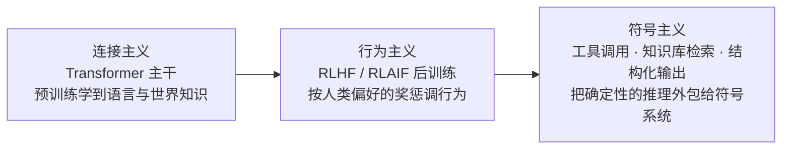
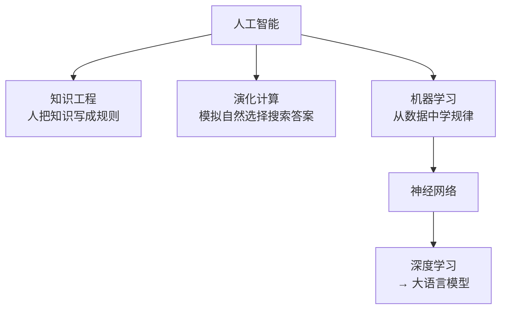

#AI #ML #概念辨析

# 人工智能的分类

> 「AI」这一个词底下装着三套互不相同的分法：按**哲学主张**分、按**要解决的问题**分、按**实现方法**分。混着说就会冒出「深度学习是不是 AI 的全部」这类问不清楚的问题

> [!note] 定位
> **这篇讲**：「AI」这个词底下的三套分法——按哲学主张分、按要解决的问题分、按实现方法分；外加工程岗位的三层分工。作用是先建立坐标系，知道自己要学的东西在整张地图的哪一格。
> **这篇不讲**：机器学习具体怎么「学」（去 [[机器学习基础概念]]）；神经网络怎么算（去 [[神经网络]]）；大模型是什么（去 [[大语言模型]]）。
> **前置**：无。全篇不含公式，是本库的第 ⓪ 篇。

## TL;DR

- **三套分法各回答一个问题**：哲学流派答「智能从哪来」，任务版图答「AI 要干什么」，实现方法答「用什么手段做」——三者交叉，不是同一棵树的三层
- **三个哲学流派**：符号主义（智能 = 推理规则）、连接主义（智能 = 大脑结构）、行为主义（智能 = 环境互动）。**连接主义赢了当下**，但另两派没死，而是变成了今天大模型系统里的组件
- **任务版图**：自然语言处理、语音技术、计算机视觉三大块。过去每个子任务一个专用模型，现在大量被一个通用大模型 + 不同提示词吃掉——这是「AI 应用开发」这个岗位得以成立的前提
- **实现方法**分三支：知识工程（人写规则）、演化计算（模拟自然选择）、**机器学习**（从数据里学）。只有第三支通向今天的大模型
- 机器学习内部还有**正交的两级**：学习方式（监督 / 自监督 / 无监督 / 强化）× 模型（线性回归 / 决策树 / SVM / 神经网络）。深度学习 = 神经网络这一支层数堆多之后的做法
- **工程岗位也分三层**：模型研发（造模型）、推理部署（让模型跑得快跑得省）、应用开发（用模型解决业务问题）

---

## 1. 三个哲学流派：智能从哪来

这是 AI 学科七十年里最根本的一次分歧——**智能的本质是什么**，三个回答催生了三条彼此独立的技术路线。

| 流派 | 主张 | 代表技术 | 现状 |
| --- | --- | --- | --- |
| **符号主义**（Symbolism） | 智能 = 推理规则 | 专家系统、知识图谱、Prolog、定理证明 | 退居配角，但以工具调用、结构化输出的形式回到了系统里 |
| **连接主义**（Connectionism） | 智能 = 大脑结构 | 神经网络、深度学习、全部大模型 | **当下绝对主流** |
| **行为主义**（Behaviorism） | 智能 = 环境互动 | 控制论、机器人学、强化学习 | 以强化学习的形式活着，并在大模型后训练阶段回到主线 |

### 符号主义：把知识写成规则

主张智能的本质是**对符号的逻辑操作**。做法是把领域知识整理成明确的符号与规则，再由推理引擎推导结论。1970-80 年代的专家系统是它的高峰——医疗诊断系统把医生的经验编成上千条「如果…那么…」，在窄领域内确实好用。

它撞上的墙叫**知识获取瓶颈**：规则必须由人手写，而常识的数量近乎无穷，且许多能力（认出一张脸、听懂一句话）人自己根本说不清规则是什么。规则库一大，彼此冲突、维护崩溃。这直接导致了 1987 年前后的第二次 AI 寒冬。

### 连接主义：不写规则，从数据里长出来

主张智能来自**大量简单单元的连接**——单个神经元只做加权求和，智能藏在连接的权重里，而权重从数据中学得，不由人指定。

这条线的时间轴：1943 年 McCulloch 与 Pitts 提出神经元的数学模型（权重由人设定）→ 1949 年 Hebb 提出学习就是改变连接强弱 → 1958 年感知机（权重从数据中自动调出）→ 1969 年 Minsky 与 Papert 证明单层感知机只能用直线划分数据、连异或都做不到，多层又不知道怎么训练，研究冷落十余年 → 1986 年反向传播让多层网络训得动 → 2012 年 AlexNet 在图像识别上碾压传统方法 → 2017 年 Transformer → 今天的大模型。每一步解决了什么、卡在哪，见 [[神经网络入门]] 的附录；神经网络本身的机制见 [[神经网络]]。

### 行为主义：在环境里试错

主张智能不在于内部有多少知识，而在于**能否在环境中做出恰当反应**。不预设目标函数之外的任何知识，靠试错和反馈调整行为。今天它的正统继承者是**强化学习**：没有标准答案，只有奖惩信号。

### 三派今天是共存的

流派之争容易被读成「一个胜出、两个淘汰」，但一个现代大模型系统里三派同时在场：

Agent 之所以要接工具、要接 MCP，正是因为神经网络不擅长精确计算与事实查询这类符号任务——**给连接主义的模型接上符号主义的外设**，是当前工程上的主流形态。

---

## 2. 按要解决的问题分：AI 的任务版图

换一把尺子，按**输入数据的模态**分，三大块：

| 领域 | 处理什么 | 典型任务 |
| --- | --- | --- |
| **自然语言处理**（NLP） | 文本 | 文本分类（情感分析、垃圾邮件识别）、机器翻译、文本生成（写文章、写代码）、问答系统（智能客服、知识问答） |
| **语音技术**（Speech） | 声音 | ASR（语音转文字）、TTS（文字转语音）、语音唤醒（唤醒词检测）、声纹识别（凭声音确认身份） |
| **计算机视觉**（CV） | 图像与视频 | 图像分类（这张是猫还是狗）、目标检测（框出图中所有行人）、语义分割（把属于同一类事物的像素划出来）、人脸识别、指纹识别、文字提取（OCR） |

还有两块横跨其上：**多模态**（同时吃文本 + 图像 + 音频，今天的主流大模型都是）与**决策与控制**（推荐、调度、机器人、自动驾驶，通常靠强化学习）。

### 大模型改变了这张表的用法

这些子任务过去各有专用架构与专用数据集——做机器翻译的模型不能拿去做情感分析。今天的变化是：**大量 NLP 子任务被一个通用大模型 + 不同提示词吃掉了**，「文本分类」退化成写一句提示词。

这件事的直接后果是，绝大多数 AI 应用不再需要训练模型，只需要会调用与编排——这就是 AI 应用开发这个岗位存在的前提（见第 5 节）。但语音与视觉的收敛程度低于文本，专用模型（如语音识别、目标检测）在生产里仍是主力。

---

## 3. 按实现方法分：三条手段

再换一把尺子，按**用什么手段造出智能**分：

- **知识工程**（Knowledge Engineering）：由人把领域知识整理成规则库或知识图谱，机器负责执行与推理。属于符号主义的工程落地。规则可解释、可审计，但覆盖面受限于人的编写能力。

- **演化计算**（Evolutionary Computation）：借自然选择的思路搜索答案——先随机生成一批候选解，用适应度函数打分，保留高分者，通过交叉与变异产生下一代，迭代逼近。遗传算法、遗传编程、粒子群优化都属此类。它的价值在于**不需要梯度**，适合目标函数不可导、搜索空间离散的问题（如排班、布线）。但在神经网络这类可导场景中它基本被梯度下降取代：梯度直接给出「往哪个方向改能变好」，而演化只能靠随机试探，效率差好几个数量级。

- **机器学习**（Machine Learning）：不预先写规则，而是给数据和结果，让程序自己找出规律。这是唯一通向今天大模型的一支，展开见 [[机器学习基础概念]]。

---

## 4. 机器学习内部：两级正交的细分

机器学习本身还要再切两刀，而这两刀是**正交**的——任选一种学习方式，配任意一种模型。

**第一刀：学习方式（正确答案从哪来）**

| 方式 | 答案从哪来 | 典型场景 |
| --- | --- | --- |
| 监督学习 | 人类标注 | 「这张是猫，这张是狗」 |
| 自监督学习 | 数据自带，由程序造出来 | 「猜下一个词」——每句话天然自带答案，大模型预训练靠它 |
| 无监督学习 | 没有答案 | 聚类、降维——「给你一堆数据，自己找结构」 |
| 强化学习 | 没有答案，只有奖惩 | 下棋、机器人控制、RLHF |

**第二刀：模型（用什么函数装规律）**

线性回归、决策树、支持向量机、神经网络……神经网络这一支层数堆多之后就是**深度学习**。

两刀正交的意思是：监督学习既可以配决策树，也可以配神经网络；强化学习配上神经网络就叫深度强化学习。**学习方式管「怎么拿到反馈」，模型管「用什么形状的函数去拟合」，互不干涉。**

四种学习方式的详细展开与「深度学习 vs 传统方法」的取舍见 [[机器学习基础概念]] 第 9、10 节；神经网络这一支从最小单元讲起见 [[神经网络]]。

---

## 5. 三套分法怎么对上

三把尺子量的是同一个东西的不同侧面，对应关系是：

| | 哲学流派 | 实现方法 | 今天的地位 |
| --- | --- | --- | --- |
| 写规则 | 符号主义 | 知识工程 | 大模型的外挂（工具、知识库） |
| 学权重 | 连接主义 | 机器学习 → 神经网络 → 深度学习 | 主干 |
| 试错 | 行为主义 | 机器学习 → 强化学习 | 后训练阶段 |
| 搜索 | （无对应流派） | 演化计算 | 小众优化问题 |

而**任务版图**（NLP / 语音 / CV）横跨这张表：同一个任务可以用任一种手段做，只是效果差距悬殊——机器翻译用规则做过（1950-80 年代的规则式翻译），做不好；换成神经网络就做成了。

---

## 6. 附：AI 工程岗位的三层分工

上面的技术分层直接映射成产业里的三类岗位。**造模型、跑模型、用模型**——需要的知识几乎不重叠。

| 层次 | 岗位名称 | 在做什么 | 核心知识 |
| --- | --- | --- | --- |
| **应用开发** | AI 应用开发工程师、Agent 应用开发工程师、大模型应用开发工程师 | 用现成模型解决业务问题 | 编程能力、AI 认知、应用框架、业务经验 |
| **推理部署** | 大模型部署工程师、LLM 推理优化工程师 | 让模型跑得更快、更省显存 | CUDA 内核、GPU 架构、算子融合、分布式推理、推理引擎、模型量化、显存优化 |
| **模型研发** | 大模型算法工程师、LLM 微调工程师、大模型训练工程师 | 造模型、改架构、训模型 | 深度学习理论、模型架构、分布式训练、数据处理、强化学习、论文复现、高等数学、线性代数、概率论、优化理论 |

三者的**需求量与门槛呈反向关系**（下表为课程给出的国内市场判断，非普适结论）：

| 层次 | 岗位需求 | 学习难度 | 薪资水平 |
| --- | --- | --- | --- |
| 应用开发 | ★★★★★ | ★★★☆☆ | ★★★☆☆ |
| 推理部署 | ★★☆☆☆ | ★★★★★ | ★★★★★ |
| 模型研发 | ★★☆☆☆ | ★★★★★ | ★★★★★ |

含义很直白：**后两类岗位单价高但坑位少，且门槛在数学与系统底层；应用开发坑位最多、门槛最低**，对已有工程背景的人是性价比最高的切入点——本库的 [[AI开发学习计划]] 走的正是这一条。

需要澄清一点：应用开发难度低是**相对**的，指的是不需要推导反向传播、不需要写 CUDA，不等于不需要懂原理。不懂上下文窗口、采样策略、KV 缓存这些机制，写出来的 Agent 会在成本和稳定性上处处踩坑——这也是本系列笔记要从神经元讲到 Agent 的原因。

---

## 相关文章

- [[AI/Index|AI 知识索引]] - 本库 AI 笔记的学习顺序与知识树，本文是它的第 ⓪ 篇
- [[机器学习基础概念]] - 第 3 节「机器学习」这一支的完整展开：数据、损失函数、梯度下降、四种学习方式
- [[神经网络]] - 连接主义的最小单元：加权求和 + 偏置 + 激活函数
- [[监督学习任务]] - 监督学习具体能做的四类事：回归、分类、搜索、推荐
- [[大语言模型]] - 连接主义这一支走到今天的形态
- [[AI开发学习计划]] - 应用开发这条路的完整学习大纲

---

## 参考资料

- 《Agents 底层逻辑》第 2 章 AI 的分类、第 1 章 必看导言（袁进）
