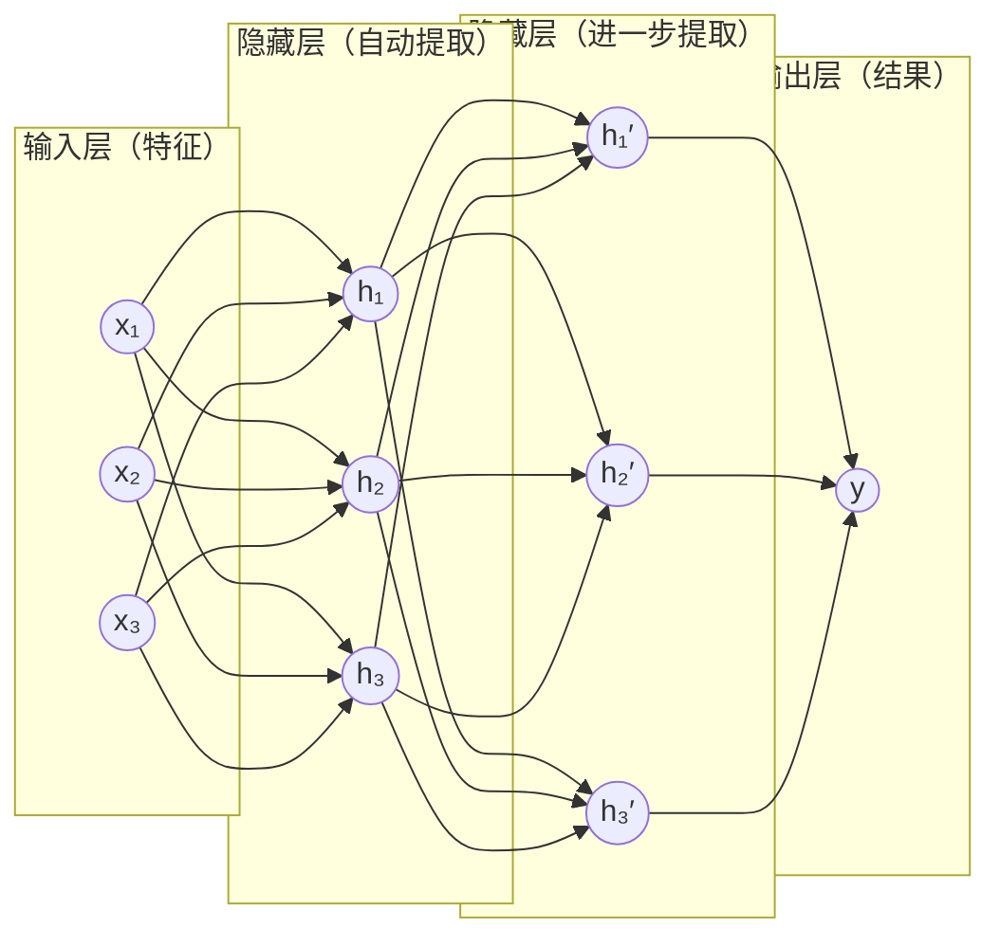

#AI #ML #deep-learning #neural-network

# 神经网络（Neural Network）

> [!note] 定位
> **这篇讲**：一次前向计算里到底发生了什么——单个神经元的公式、四个术语、激活函数为什么非有不可、一层怎么并行算完、**为什么要堆多层**、**输出层为什么必须单独存在**、参数量怎么数。
> **这篇不讲**：这些参数是怎么被训练出来的（去 [[神经网络的训练过程]]）；求导与梯度（去 [[导数、偏导与链式法则]]）；注意力与 Transformer 这类具体架构（去 [[Transformer]]）。
> **前置**：[[向量与数量积]]（加权求和）、[[矩阵与线性变换]]（一层 = 一次矩阵乘法）。没读过也能跟下来，卡在公式时再回去补。

## TL;DR

- **神经网络 = 一个带大量待定参数的复合函数**，整个定义就是 $y = \mathrm{sigmoid}\big(W_2 \cdot \mathrm{ReLU}(W_1 x + b_1) + b_2\big)$——注意隐藏层用 ReLU、输出层用 sigmoid，**这两处不是同一个函数**
- 全篇约定：**$\sigma$ 只表示「某个激活函数」，具体是哪一个一律写名字**
- **神经元** = 加权求和 + 偏置 + 激活函数（最小计算单元）：吃一个向量，吐一个标量，写成 $y = \sigma(\sum_i w_i x_i + b)$
- **权重**决定各输入的重要性；**偏置**给加权和加一个常数偏移，决定输出从哪个位置开始变正
- **激活函数是一个固定的非线性函数**，唯一作用是让这个神经元不再是一条直线；没有它，叠再多层都等价于一层
- **ReLU 的具体做法是给函数一个折点**，单输入时折点在 $x = -b/w$，位置由训练出来的 $w$、$b$ 决定（多输入时折的是一个平面）；**一层里 $n$ 个 ReLU 就有 $n$ 个折点，把输入轴切成 $n+1$ 段直线**，段数够多就能逼近任意曲线
- **隐藏层**之所以"隐藏"，是因为它的输出既非你给的输入、也非最终结果，从外部看不见
- **一层 = 一次矩阵乘法**，整层神经元并行算完 → 这是 GPU 派上用场的地方
- **多层不是为了「能不能」，是为了「要花多少神经元」**：单隐藏层就足以逼近任意函数（万能逼近定理），但**宽度靠加法、深度靠乘法**——20 个神经元排成一层给 21 段直线，排成 10 层每层 2 个给 1024 段
- **输出层要单独存在**，因为它做三件隐藏层不做的事：把形状拧成任务要的个数、把值域拧成任务要的范围（所以它的激活函数和隐藏层不同）、给每个数指定含义（损失函数就是对着它算的）
- **训练**就是找出全部权重和偏置；"7B 参数"就是这样的数有 70 亿个
- **"神经"是历史包袱**，与真实大脑关系很浅，不必从生物学角度理解

---

## 1. 先看它算出一个数

任务：根据"复习小时数"和"睡眠小时数"，预测考试能否通过。
结构：2 个输入 → 2 个隐藏神经元 → 1 个输出。

全部参数如下（先别管哪来的，第 8 节说）：

```text
隐藏神经元 h₁:  权重 (0.5, 0.2)   偏置 −4
隐藏神经元 h₂:  权重 (0.1, 0.5)   偏置 −3
输出神经元  y:  权重 (1.5, 0.8)   偏置 −1
```

输入：复习 6 小时、睡 8 小时，即 x = (6, 8)。

**第一步，算 h₁**——输入与权重逐位相乘再求和（即数量积，俗称点积），加上偏置，过激活函数：

```text
0.5×6 + 0.2×8 + (−4) = 3 + 1.6 − 4 = 0.6
ReLU(0.6) = 0.6                          ← 正数原样通过
```

**第二步，算 h₂**，同样做法：

```text
0.1×6 + 0.5×8 + (−3) = 0.6 + 4 − 3 = 1.6
ReLU(1.6) = 1.6
```

**第三步，输出层**。注意它的输入不再是原始数据，而是上一层的两个结果 (0.6, 1.6)：

```text
1.5×0.6 + 0.8×1.6 + (−1) = 0.9 + 1.28 − 1 = 1.18
```

再过一道 Sigmoid（把任何数压进 0~1 的函数，见第 4 节末尾的对照表）当概率读：

$$\mathrm{sigmoid}(1.18) = \frac{1}{1 + e^{-1.18}} = 0.76$$

**结论：通过概率 76%。** 整个神经网络做的就是这七八次乘加，没有别的。

换几组输入看它的行为：

| 输入 | h₁ | h₂ | 输出层加权和 | 概率 |
|---|---|---|---|---|
| 复习 6，睡 8 | 0.6 | 1.6 | 1.18 | 76% |
| 复习 2，睡 8 | **0** | 1.2 | −0.04 | 49% |
| 复习 10，睡 8 | 2.6 | 2.0 | 4.50 | 99% |
| 复习 6，睡 3 | **0** | **0** | −1.00 | 27% |

复习越久概率越高、睡眠不足则大幅下降——这个函数确实"学会"了一点东西。表格里三处 0 是 ReLU 把负数砍掉的结果，第 3 节会说明这一刀的意义。

---

## 2. 一个神经元：公式与四个术语

第 1 节那一串计算，标准写法是：

$$y = \sigma\!\left(\sum_{i=1}^{n} w_i x_i + b\right) = \sigma(w_1 x_1 + w_2 x_2 + \cdots + w_n x_n + b)$$

一个神经元的全部定义就是这一行。逐项对照：

| 记号 | 名称 | 是什么 |
| --- | --- | --- |
| $[x_1, \dots, x_n]$ | **输入值** | 一个向量，每个分量是一个维度的信息 |
| $[w_1, \dots, w_n]$ | **权重** | 每个权重表示对应维度的信息有多重要 |
| $b$ | **偏置** | 给加权和加一个常数偏移，决定输出从哪个位置开始变正 |
| $\sigma$ | **激活函数** | 一个固定的非线性函数，让这个神经元不再是一条直线；最常用 $\mathrm{ReLU}(z) = \max(0, z)$ |
| $y$ | **输出值 / 激活值** | 一个标量 |

权重和偏置合称**参数**——这是训练要找的那批数。三个要点：

- **单个神经元吃一个向量，吐一个标量**，向量长度 $n$ 由上一层有几个神经元决定
- **激活函数是固定的**，由人在设计网络时选定，训练过程中不会改变（属于超参数，见 [[模型里的四类数字]]）
- 于是**参数唯一地决定了这个神经元算得对不对**——训练能动的只有权重和偏置

### 权重：各输入的重要性

某个输入对这个神经元有多重要，数值上相当于斜率。h₁ 里复习的权重 0.5 大于睡眠的 0.2，说明它更看重复习。

拆开这个词组：**「加权」= 有的乘大数有的乘小数，「求和」= 加起来**。

### 偏置：加权和的常数偏移

h₁ 的偏置是 −4，意思是加权和要先超过 4，$z$ 才为正、ReLU 才输出非零值。看上表第二行：复习只有 2 小时时加权和是 2.6，不够 4，减完变负，被 ReLU 砍成 0。

一般地，**输出开始变正的位置由 $-b$ 决定**——第 4 节会看到，这个位置就是 ReLU 折点的位置。

---

## 3. 激活函数：为什么非有不可

先把它在计算里的位置钉死。一个神经元分两步，激活函数是第二步：

```text
第一步（线性）:  z = w₁x₁ + w₂x₂ + ... + b      ← 参数全在这里
第二步（激活）:  y = σ(z)                        ← 没有任何参数
```

$\sigma$ 吃一个数、吐一个数，逐个神经元独立作用，不混合不同神经元的值。**它整个身家就是「把 z 换成另一个数」这一个动作。**

### 名字是个坑

「激活」来自生物神经元「电位超过阈值才放电」。但在数学上它的正式称呼是 **nonlinearity（非线性函数）**——论文里就是这么叫的。每次读到「激活函数」时在心里换成「非线性函数」，困惑会少一半：**它的职责是让这个神经元不再是一条直线，不是别的。**

### 用一组能验算的数字看它做了什么

三个神经元，权重都是 1，偏置分别是 −10、−22、−34；输出层把它们按 $1, -2, 1$ 加起来：

```text
h₁ = σ(x − 10)      h₂ = σ(x − 22)      h₃ = σ(x − 34)
y  = 1·h₁ − 2·h₂ + 1·h₃
```

**$\sigma$ 取 ReLU 时**（负数变 0，正数不变）：

| x | h₁ | h₂ | h₃ | y |
|---|---|---|---|---|
| 4 | 0 | 0 | 0 | **0** |
| 10 | 0 | 0 | 0 | **0** |
| 16 | 6 | 0 | 0 | **6** |
| 22 | 12 | 0 | 0 | **12** |
| 28 | 18 | 6 | 0 | **6** |
| 34 | 24 | 12 | 0 | **0** |
| 40 | 30 | 18 | 6 | **0** |

一个先升后降的三角形。**把 $\sigma$ 去掉**（也就是令 $\sigma(z) = z$），同样这组参数：

$$y = (x-10) - 2(x-22) + (x-34) = x - 10 - 2x + 44 + x - 34 = 0$$

三个神经元的贡献直接相互抵消，**输出恒等于 0**，网络什么也算不出来。

### 这不是参数选得巧

把两层展开就知道为什么：

$$W_2(W_1 x + b_1) + b_2 = (W_2W_1)\,x + (W_2b_1 + b_2)$$

$W_2W_1$ 仍然是一个矩阵，$W_2b_1 + b_2$ 仍然是一个向量——结果仍是 $Wx + b$ 的形式。**无论叠多少层、每层放多少神经元，去掉激活函数后整个网络能算出来的永远只有一条直线**（多输入时是一个平面）。

而「先升后降」这件事，直线做不到。**激活函数买来的就是这个能力，仅此而已。**

---

## 4. ReLU：折点落在哪里

读作 **"瑞露"**（/ˈrelʊ/），全称 Rectified Linear Unit（修正线性单元）。规则极其简单：**负数变 0，正数不变。**

```text
ReLU(-3) = 0     ReLU(0) = 0     ReLU(5) = 5
```

### 折点的位置：$x = -b / w$

> 从这里开始换用**单输入**的网络（就是上一节那个）。原因是：只有单输入时，折点才是数轴上的一个点、$x = -b/w$ 才写得出来。第 1 节的 h₁ 有两个输入，它折的地方是平面上的一条直线 $0.5x_1 + 0.2x_2 - 4 = 0$——机制完全一样，但画不进一维的表格里。

关键在于「负数变 0」这个动作**发生在哪个位置**。对上一节的 h₁ 来说 $z = x - 10$，所以 x 走过 10 的那一刻，h₁ 从「被砍成 0」切换到「原样输出」——函数在这里出现一个**折点**。一般地：

$$w \cdot x + b = 0 \quad \Longrightarrow \quad x = -\frac{b}{w}$$

三个神经元的偏置是 −10、−22、−34，权重都是 1，于是三个折点落在 $x = 10, 22, 34$——正是上一节表格里 y 改变走向的三个位置。这也回答了第 2 节留下的问题：**偏置的作用就是决定折点落在哪里。**

**折点位置由 $w$ 和 $b$ 共同决定，而 $w$、$b$ 是训练出来的**——所以「在哪儿拐弯、每段多陡」是模型学的，「用哪种方式拐」是人定的。

### 每一段区间内部，仍然是一条直线

把 x 轴按三个折点切开，逐段看这个网络在算什么：

| x 的区间 | 输出非零的神经元 | 这一段的 y | 斜率 |
|---|---|---|---|
| x < 10 | 无 | 0 | 0 |
| 10 ~ 22 | h₁ | $x - 10$ | +1 |
| 22 ~ 34 | h₁、h₂ | $-x + 34$ | −1 |
| x > 34 | h₁、h₂、h₃ | 0 | 0 |

注意最右边那列：**在每一个区间内部，网络仍然是一条直线。** 激活函数并没有把网络变成曲线——它是让网络**在不同的输入区间里换用不同的直线**。

**段数怎么数**：$n$ 个 ReLU 就有 $n$ 个折点，折点把输入轴切成 **$n+1$ 段**。上表 3 个神经元、折点在 10 / 22 / 34，正好 4 段——可以对着表格数。

> 网上常见的说法是「$n$ 个神经元各有开关两种状态，所以最多 $2^n$ 段」。$2^n$ 是组合数的上界，**单输入时根本达不到**：$x$ 从左往右扫过去只能依次翻过 10、22、34 三个折点，8 种组合里能出现的只有 4 种。以后撞见 $2^n$，知道它是怎么来的就行。

段数只随神经元个数**线性**增长，所以要逼近得细就得加神经元：

```text
3 个神经元   → 4 段折线，很粗糙
100 个神经元 → 101 段，密到看起来像光滑曲线
```

这就是「神经网络能逼近任何函数」（万能逼近定理）的全部机制，没有别的玄机。

### 它不参与训练

$\sigma$ 是设计网络时人选定的，训练过程中一个字节都不会变——属于**超参数**，不属于参数（两者的分界见 [[模型里的四类数字]]）。训练动的只有 $w$ 和 $b$。

### 为什么默认用 ReLU 而不是 Sigmoid

Sigmoid 把任何数压进 0~1，形状上更接近生物神经元的放电曲线，但它的导数最大只有 0.25。反向传播是一串乘法，每穿过一层就乘一次那层的导数，十几层之后梯度连乘到接近 0，前面的参数收不到有效信号——这叫**梯度消失**，是深层网络在 2010 年前训不动的主因之一（完整解释见 [[导数、偏导与链式法则]] 第 6 节）。

ReLU 在正半轴的导数恒为 1，乘多少层都不衰减，且计算只是一次比较，极快。

### 常见的其他选择

| 激活函数 | 作用 | 常见位置 |
|---|---|---|
| ReLU | 负数归零，简单快、不易梯度消失 | 隐藏层默认选择 |
| Sigmoid | 压进 0~1 | 二分类的输出层（第 1 节例子用的就是它） |
| Softmax | 一组数压成和为 1 的概率分布 | 多分类输出层、注意力权重 |
| GELU / SiLU | ReLU 的平滑版，负半轴不再恒为 0 | 现代大模型的隐藏层 |

两条补充：

- **softmax 是这张表里唯一的例外**：它一次吃一整个向量、要看同层其他神经元的值，**不满足本节开头「逐个神经元独立作用」那条**。它只出现在输出层和注意力权重里（见 [[Transformer]]）。
- **ReLU 的代价叫 dead ReLU（神经元死亡）**：$z$ 长期为负时它的导数是 0，梯度乘 0 之后这个神经元的权重就再也不动了。GELU / SiLU 让负半轴的导数不完全为 0，正是冲这个来的（见 [[导数、偏导与链式法则]] 第 2 节）。

---

## 5. 从一个神经元到一层

### 隐藏层 = 看不见的中间结果

h₁、h₂ 既不是你给的输入，也不是最终输出，从外部完全观察不到——只有输入和输出可见，中间层全藏在里面，所以叫**隐藏层**。



每个圆圈是一个神经元（一次加权求和 + 偏置 + 激活），每条连线是一个权重参数。图中两个隐藏层各 3 个神经元，所以第二层的权重矩阵是 3 行 3 列。

### 层 = 并排的一批神经元，一次矩阵乘法算完

h₁ 和 h₂ 吃同一份输入、互不依赖，因此可以同时算，它们同属一层。写成矩阵就是一次运算（见 [[矩阵与线性变换]]）：

$$h = \text{ReLU}\!\left(\begin{bmatrix}0.5 & 0.2\\ 0.1 & 0.5\end{bmatrix}\begin{bmatrix}6\\8\end{bmatrix} + \begin{bmatrix}-4\\-3\end{bmatrix}\right) = \text{ReLU}\begin{bmatrix}4.6 - 4\\4.6 - 3\end{bmatrix} = \begin{bmatrix}0.6\\1.6\end{bmatrix}$$

**权重矩阵的每一行 = 一个神经元的权重。** 一次矩阵乘法把整层算完——这就是 GPU 能大幅加速训练的原因。

### 通用写法：给层和神经元编号

上面是具体数字，读论文和代码时会遇到带编号的通用形式。约定：**上标 $(l)$ 表示第几层，下标 $j$ 表示这一层的第几个神经元。**

$$a^{(l)}_j = \sigma\!\left(\sum_{i=1}^{m} w^{(l)}_{ji}\, a^{(l-1)}_i + b^{(l)}_j\right)$$

读法：第 $l$ 层第 $j$ 个神经元的输出，等于把**上一层全部 $m$ 个输出**加权求和、加偏置、再过激活函数。权重的双下标 $w_{ji}$ 是「从上一层第 $i$ 个连到本层第 $j$ 个」。

整层一次算完就是矩阵形式：

$$\mathbf{a}^{(l)} = \sigma\!\left(\mathbf{W}^{(l)} \mathbf{a}^{(l-1)} + \mathbf{b}^{(l)}\right)$$

| 记号 | 含义 | 尺寸 |
| --- | --- | --- |
| $\mathbf{a}^{(l-1)}$ | 上一层的输出向量 | $m \times 1$ |
| $\mathbf{W}^{(l)}$ | 本层的权重矩阵 | $n \times m$ |
| $\mathbf{b}^{(l)}$ | 本层的偏置向量 | $n \times 1$ |
| $\mathbf{a}^{(l)}$ | 本层的输出向量 | $n \times 1$ |

**尺寸是自洽的**：本层有 $n$ 个神经元、上一层有 $m$ 个，所以权重矩阵必然是 $n$ 行 $m$ 列。看到一个陌生网络的层配置，用这条就能反推出每个矩阵多大。

---

## 6. 为什么要堆多层

把第 1 节那三步合起来，就是整个网络：

$$y = \mathrm{sigmoid}\big(W_2 \cdot \mathrm{ReLU}(W_1 x + b_1) + b_2\big)$$

**神经网络的全部定义就是这一行。** 所谓"深"，只是这个套娃再多套几十上百层：

$$y = \mathrm{sigmoid}\big(W_n \cdot \mathrm{ReLU}(\cdots \mathrm{ReLU}(W_1 x + b_1)\cdots) + b_n\big)$$

（外层写 sigmoid、内层写 ReLU，是因为它们确实是两个不同的函数：隐藏层用 ReLU，做二分类的输出层用 sigmoid，理由见第 7 节。）

把这个式子从第 1 层一路算到最后一层，就叫**前向传播**（见 [[神经网络的训练过程]]）。

### 先说一个反直觉的事实：单层就已经够用

**万能逼近定理**（universal approximation theorem）说的是：只要神经元数量不限，**一个隐藏层**就能把任意连续函数逼近到任意精度。

所以「必须多层才能表达复杂函数」是错的。多层要解决的不是**能不能**，而是**要花多少神经元**。

### 宽度靠加法，深度靠乘法

回到第 4 节数过的段数：一层里 $n$ 个 ReLU 有 $n$ 个折点，切出 $n+1$ 段。**加神经元是加法，段数线性增长。**

多层不一样，因为下一层拿的是上一层的输出——这是**函数复合**。

用一个能手算的例子。两个 ReLU 神经元可以拼出一个「帐篷」：

$$f(x) = 2\,\mathrm{ReLU}(x) - 4\,\mathrm{ReLU}(x - 0.5)$$

在 $[0, 1]$ 上验算（可以自己代进去核对）：

| $x$ | 0 | 0.25 | 0.5 | 0.75 | 1 |
|---|---|---|---|---|---|
| $f(x)$ | 0 | 0.5 | **1** | 0.5 | 0 |

一个在 0.5 处到顶的帐篷，2 段直线。关键性质是：**它把 $[0,1]$ 映回 $[0,1]$，所以它的输出可以原样喂给下一层同样的两个神经元。**

那 $f(f(x))$ 长什么样？$f$ 的上升段和下降段各自都铺满了整个 $[0,1]$，于是第二层在**每一段上都完整地折一次**：

| $x$ | 0 | 0.25 | 0.5 | 0.75 | 1 |
|---|---|---|---|---|---|
| $f(x)$ | 0 | 0.5 | 1 | 0.5 | 0 |
| $f(f(x))$ | 0 | **1** | 0 | **1** | 0 |

两个帐篷，4 段直线。再复合一次是 8 段。**每加一层，段数翻倍。**

于是同样是 20 个神经元：

```text
排成 1 层，20 个        →  21 段        （n + 1，加法）
排成 10 层，每层 2 个   →  2¹⁰ = 1024 段（每层翻倍，乘法）
```

**这就是「深」的全部价值：宽度花的是加法，深度花的是乘法。** 单层要达到深层的表达力，神经元数量得指数级增长——理论上做得到，工程上做不到。

### 换个角度：后面的层可以复用前面的层

上面是数段数，同一件事换成特征的语言就是：每层把上一层的发现组合成更复杂的发现，第 3 层不必从原始像素重新找眼睛，它直接用第 2 层已经找到的边缘和纹理。

最经典的证据来自图像识别的**卷积网络**（CNN，见第 9 节），把各层神经元最敏感的输入画出来，大致是：

```text
第1层：边缘、线条
第2层：纹理、角、简单形状
第3层：眼睛、耳朵、鼻子
第4层：整张脸
```

这是**观测到的现象**，不是从公式推出来的必然结论；本篇讲的全连接网络没有这么整齐的可视化，但「复用」这个机制是共通的。

### 深了也有代价

层数不是越多越好。反向传播是一串乘法，层一多梯度就容易衰减到 0（或者炸掉），前面的层收不到信号——见 [[导数、偏导与链式法则]] 第 6 节。**残差连接**正是为了解决这个才被发明的（见 [[Transformer]]）。现代网络能做到几十上百层，靠的不只是「多堆几层」。

**神经网络 ⊋ 深度学习**：只要神经元按层连接就算神经网络，含单层感知机和只有一个隐藏层的浅层网络；深度学习特指层数多起来之后的情形，惯例上两层以上隐藏层算「深」。

---

## 7. 输出层：网络和任务之间的接口

前面所有层长得都一样，为什么最后一层要单独拿出来说？因为它承担了三件隐藏层不做的事。

### 一、把形状拧成任务要的样子

隐藏层有几个神经元，是**你按算力预算定的**（第 1 节挑了 2 个，大模型里是 4096 个），和任务本身没关系。但任务要的输出形状是**定死的**：

| 任务 | 输出必须是几个数 |
|---|---|
| 预测房价（回归） | 1 |
| 判断能否通过（二分类） | 1 |
| 手写数字识别（10 类） | 10 |
| 大模型预测下一个词 | 32000（词表大小） |

第 1 节那个输出神经元干的就是这件事：**把隐藏层的 2 个数压成 1 个数**。它的权重矩阵是 1 行 2 列——行数 = 任务要的输出个数，列数 = 上一层的宽度。第 5 节那条尺寸规则在这里同样成立。

### 二、把值域拧成任务要的范围

这是输出层和隐藏层**最实质的区别：两者通常用不同的激活函数。**

隐藏层用 ReLU，输出恒 ≥ 0 且没有上界。但任务要的往往不是这个范围：

- 概率必须落在 0~1 → **sigmoid**
- 多个类别的概率还要加起来等于 1 → **softmax**
- 房价、温度这类可正可负或范围不限的量 → **不加激活函数**（恒等）

对着第 1 节那张表就能看出必要性：输出层的加权和出现过 **−1.00**（复习 6、睡 3 那一行）。**如果这里也用 ReLU，−1.00 会被砍成 0，「有多不可能通过」这个信息就全丢了**；换成 sigmoid，−1.00 变成 27%，信息完整保留。

### 三、给每个数指定含义

隐藏层每个神经元算出来的数**没有人规定它是什么意思**——那是网络自己找的中间特征，h₁ 看起来像「努力程度」只是巧合。而输出层的每个数是**有指定含义的**：第 $i$ 个数就是第 $i$ 类的得分。

这件事有个直接后果：**损失函数是对着输出层的数算的**。「预测和标准答案差多少」这句话只有在输出层才说得通，因为只有那里的数和标准答案是同一种东西。所以输出层是「网络内部」与「人的目标」之间的接口。

### 能不能省掉它

不能。如果拿最后一个隐藏层直接当输出，就被迫接受两件事：输出个数只能等于那层的宽度，输出值域只能是 ReLU 的 $[0, \infty)$。两个都不可接受。

> **落到大模型上**：LLaMA-2 的隐藏层宽 4096，读完一句话后得到一个 4096 维的「理解状态」；输出层是一个 32000×4096 的矩阵，把它映射成 32000 个词各自的得分（这些得分叫 **logits**），再过 softmax 变成概率。这一步在 [[AI/Map|AI 知识地图]] 里叫**输出头**——干的正是本节第一件事：把 4096 拧成 32000。

---

## 8. 参数从哪来

第 1 节直接给了 9 个数，它们的构成是：

```text
隐藏层: 2 个神经元 × 2 个输入 = 4 个权重  +  2 个偏置
输出层: 1 个神经元 × 2 个输入 = 2 个权重  +  1 个偏置
────────────────────────────────────────────────
合计 9 个参数
```

写成通用公式，$n_l$ 表示第 $l$ 层的神经元个数（$n_0$ 就是输入维度）：

$$\text{总参数量} = \sum_{l=1}^{L}\left(n_l \times n_{l-1} + n_l\right)$$

每一层贡献两块：$n_l \times n_{l-1}$ 个权重（本层每个神经元连上一层每个输出）加 $n_l$ 个偏置（每个神经元一个）。拿到任何一个网络的层配置，用这条就能算出它有多少参数。

**这 9 个数不是人写的，是训练出来的**——完整过程（前向传播 → 损失 → 反向传播 → 梯度下降的四环节循环）见 [[神经网络的训练过程]]。

所以"7B 参数模型"的意思就是这样的数有 70 亿个，GPT-3 的 1750 亿同理。**结构上和上面这个 9 参数的小网络没有本质区别，只是数量级不同。**

---

## 9. 变体，以及"神经"这个名字

### 四种变体

| 变体 | 连接方式 | 擅长 |
| --- | --- | --- |
| **全连接网络** | 每个神经元连接上一层所有神经元（本篇讲的就是它） | 表格数据 |
| **CNN**（卷积神经网络） | 用一个固定大小的权重窗口在图上滑动扫描，同一组权重在所有位置复用 | 图像 |
| **RNN**（循环神经网络） | 带记忆，逐步处理序列 | 语音、文本 |
| **Transformer** | 用注意力机制全局连接 | 当前主流（GPT、BERT） |

它们都是神经网络，区别只在"哪些神经元连哪些"以及"权重怎么共享"，第 1 节那套加权求和 + 偏置 + 激活的机制完全不变。详见 [[序列模型]] 与 [[Transformer]]。

### 一个必然的困惑：Transformer 里也有个部件叫「前馈网络」

上表里 **Transformer 和全连接网络是兄弟**（同属神经网络这一类）。但读 [[Transformer]] 时会发现，Transformer 的**每一层里又嵌了一个全连接网络**，叫「前馈子层」。听起来像自我包含，其实是**同一个词用在了两个尺度上**：

| 尺度 | 「神经网络 / 前馈网络」指什么 | 例子 |
|---|---|---|
| **模型分类** | 一**类**模型：神经元按层连接 | Transformer 是神经网络的一种 |
| **架构部件** | 架构图上一个**方块**：最朴素的那种全连接网络 | Transformer 每层里的前馈子层 |

所以准确的说法是：**Transformer 整体属于神经网络这一类，而它在自己每一层里嵌了一个最经典形态的全连接网络。**

验证「Transformer 整体是神经网络」很容易——把它每一步用的运算列出来，全部是加权求和（矩阵乘法）、非线性（softmax、SiLU）、加减与缩放（残差、归一化），**没有一步跳出本篇第 1 节那个模式**，参数也全是连接权重。

那前馈子层特殊在哪？两点：**不跨位置**（每个位置各算各的，而注意力是全层唯一让位置之间交流的地方），以及**权重全是训练出来的固定参数**——注意力子层里 softmax 之后那个注意力权重是**当场按数据算出来的**，前馈子层没有这种东西，是原汁原味的经典形态。

名字这么乱是历史遗留：Transformer 之前，「前馈」是拿来和**循环网络（RNN）**对比的，指「信息只向前流、没有回路」，那个年代它基本就是全连接网络的代称。2017 年的论文沿用了这个旧词。但严格按定义，整个 Transformer 也没有回路、也是前馈的——完整辨析见 [[Transformer]] 第 9 节。

### "神经"是历史包袱

1943 年 McCulloch 与 Pitts 提出这个模型时，灵感确实来自生物神经元的"接收信号 → 超过阈值 → 放电"，第 2 节偏置那个常数偏移就是这个阈值的残影。

但现代神经网络与真实大脑的相似度非常低：反向传播在生物学上没有对应机制，真实神经元的行为也远比加权求和复杂。**这个名字是历史遗留，它不提供任何理解上的帮助，反而容易让人以为里面藏着类脑的玄机。** 把它当作"一个参数很多的分段线性函数"来理解，更接近实情。

### 和之前知识的对应

| 之前学的概念 | 其实就是 |
| --- | --- |
| `y = w×x + b`（线性回归） | 一个没有激活函数的单个神经元 |
| 参数 w | 神经元之间连线上的权重 |
| 参数 b | 神经元加权和上的常数偏移 |
| 数量积 | 一个神经元的加权求和 |
| 矩阵乘法 | 一整层神经元的加权求和 |
| "学习" | 调整所有权重和偏置，让损失函数最小 |

---

## 自测

都能在纸上算完，答案在下方。

1. 用第 1 节那组参数，算输入「复习 4 小时、睡 6 小时」时的 h₁、h₂ 和输出层加权和。
2. 某神经元权重 2、偏置 −6，过 ReLU。它的折点在 x 等于多少？x 小于折点时它输出什么？
3. 一个全连接网络结构是 4 输入 → 8 → 8 → 1，总共有多少个参数？
4. 把第 1 节那个网络的两个 ReLU 都去掉，它还能表达「复习和睡眠都要够，概率才高」这种关系吗？为什么？
5. 某个 ReLU 神经元在当前这批数据上 $z$ 一直是负数。它输出什么？训练时它的权重会被更新吗？
6. 一个隐藏层有 5 个 ReLU 神经元，最多能把输入切成多少段直线？
7. 用第 6 节那个帐篷构造（每层 2 个 ReLU）。10 个神经元**排成一层**最多切出几段？**排成 5 层、每层 2 个**呢？
8. 某人做气温预测（可能是零下），输出层用了 ReLU。会出什么问题？

<br/>

> [!success]- 答案
> 1. $h_1 = 0.5{\times}4 + 0.2{\times}6 - 4 = -0.8 \to \mathrm{ReLU} \to \mathbf{0}$；$h_2 = 0.1{\times}4 + 0.5{\times}6 - 3 = 0.4 \to \mathbf{0.4}$；输出层 $= 1.5{\times}0 + 0.8{\times}0.4 - 1 = \mathbf{-0.68}$（过 Sigmoid 约 34%）。注意 h₁ 又被砍成了 0——复习 4 小时没过它的折点。
> 2. 折点 $x = -b/w = 6/2 = \mathbf{3}$。$x < 3$ 时 $z$ 为负，ReLU 输出 **0**。
> 3. 第 1 层 $8{\times}4 + 8 = 40$，第 2 层 $8{\times}8 + 8 = 72$，第 3 层 $1{\times}8 + 1 = 9$，合计 **121 个参数**。
> 4. **不能。** 去掉后整个网络退化成 $y = (\text{某组常数}) \cdot x + \text{常数}$，是一个平面。平面在任何方向上都是单调的——复习越多概率单调升、睡眠越多概率单调升，无法表达"两者都要够才行"这种需要拐折的关系。
> 5. 输出恒为 **0**；**不会被更新**。ReLU 在负半轴导数为 0，梯度乘 0 还是 0，梯度下降那一步的挪动量是 0。这个现象叫 **dead ReLU**（神经元死亡），见 [[导数、偏导与链式法则]] 第 2 节。
> 6. **6 段**（$n+1$）。注意不是 $2^5$——理由见第 4 节那条注。
> 7. 排成一层：$10 + 1 = \mathbf{11}$ 段。排成 5 层每层 2 个：每层翻倍，$2^5 = \mathbf{32}$ 段。同样 10 个神经元，**加法给 11，乘法给 32**；层数再多，差距按指数拉开。
> 8. 所有零下的预测都会被 ReLU 砍成 0，**模型永远输不出负温度**。回归任务的输出层通常**不加激活函数**（恒等），让它能输出任意实数。

---

## 相关文章

- [[神经网络的训练过程]] - 这些参数怎么被找出来：前向传播、损失、反向传播、梯度下降
- [[导数、偏导与链式法则]] - 本篇提到的梯度消失、dead ReLU 的数学解释
- [[模型里的四类数字]] - 本篇第 1 节那 9 个数属于哪一类，与超参数、特征、激活值怎么分
- [[向量与数量积]] - 加权求和与数量积的数学地基
- [[线性代数入门]] - 线性 / 仿射 / 非线性的区别，解释第 3 节为什么必须有激活函数
- [[矩阵与线性变换]] - 一层 = 一次矩阵乘法，本篇第 5 节的矩阵形式
- [[机器学习基础概念]] - 损失函数、过拟合、深度学习 vs 传统方法
- [[人工智能的分类]] - 神经网络在 AI 版图里的位置：连接主义这一支的技术载体
- [[序列模型]] - RNN、CTC、Attention
- [[Transformer]] - 自注意力、QKV、BERT/GPT/T5 三大流派

---

## 参考资料

- 《动手学深度学习》第一章 - 引言
- 《Agents 底层逻辑》第 3 章 神经元、第 4 章 前向传播（袁进）
