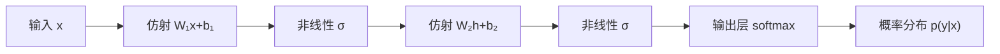

#AI #neural-network #原始问答

# 原始问答：神经网络是一个函数

> 2026-11-03 至 11-04 学习神经网络时的原始问答记录，按提问顺序保留。整理后的文章见 [[神经网络入门]]。
>
> 只做了两处格式调整：回答里的标题各降一级，以免和「第 N 问」冲突；指向库内文件的链接改成了双链。文字内容没有改动，所以这里的说法可能与整理版不完全一致，**以整理版为准**。

---

## 第 1 问

> 怎样从数学上理解神经网络的运行过程？

从数学上看，**神经网络就是一个带参数的函数 $f(x;\theta)$**，由很多个简单函数复合（嵌套调用）而成。它的"运行"分成两件事：

- **前向传播**：给定参数 $\theta$，算出函数值 $f(x;\theta)$。用到的是**线性代数**。
- **训练**：调整 $\theta$，让函数值逼近目标。用到的是**微积分**（求梯度）和**概率统计**（定义"逼近"的标准）。

下面按这三层来讲。

### 1. 单层：仿射变换加一个非线性函数

一层网络做的计算是：

$$h = \sigma(Wx + b)$$

- **$Wx$（矩阵乘向量）**：$W$ 的每一行和输入 $x$ 做一次数量积，得到一个数。数量积衡量的是"$x$ 在这一行方向上投影有多长"，所以每个神经元其实是在问：输入和我关心的那个方向有多接近？
- **$+b$（偏置）**：给结果整体平移。
- **$Wx+b$ 合起来叫仿射变换**，也就是线性变换（旋转、拉伸、剪切、投影）再加一次平移。
- **$\sigma$（激活函数）**：对每个分量单独施加的非线性函数，比如 ReLU：$\sigma(z)=\max(0,z)$。

### 2. 多层：函数复合，非线性必须有

$L$ 层网络就是把每层的函数一层套一层：

$$f(x) = f_L\big(f_{L-1}(\cdots f_1(x))\big)$$

**为什么一定要有 $\sigma$**：如果没有它，两层仿射变换合起来是

$$W_2(W_1x+b_1)+b_2 = (W_2W_1)\,x + (W_2b_1+b_2)$$

结果还是一个仿射变换。不管堆多少层，效果都等于一层，也就只能画出直线（高维时是平面）。非线性函数正是阻止这种"坍缩"的东西。

### 3. 几何视角：一层一层地把空间"折叠"

这是我觉得最能建立直觉的一种理解：

- 仿射变换把整个输入空间旋转、拉伸、平移，但直线变换后还是直线。
- ReLU 把每个坐标的负半轴都压到 0，相当于沿着坐标轴把空间**折叠**一次。
- 多层叠在一起，就是"变换、折叠、再变换、再折叠"。原本混在一起的类别，被逐渐揉到可以用一个平面分开的位置。**最后一层其实只是一个线性分类器**，前面那些层的作用，是把数据变换到线性分类器能处理的形状。

**例子：异或（XOR）**。点 (0,0)、(1,1) 属于类别 0，点 (1,0)、(0,1) 属于类别 1。在原始平面上，用一条直线分不开这两类。现在取：

- 隐藏层：$h_1=\text{ReLU}(x_1+x_2)$，$h_2=\text{ReLU}(x_1+x_2-1)$
- 输出层：$y = h_1 - 2h_2$

| 输入 | $(h_1,h_2)$ | $y$ |
|---|---|---|
| (0,0) | (0,0) | 0 |
| (1,0) | (1,0) | 1 |
| (0,1) | (1,0) | 1 |
| (1,1) | (2,1) | 0 |

隐藏层把 (1,0) 和 (0,1) **折叠到了同一个点**。在新的空间里，两类已经可以用一条直线分开，输出层只需要做一次线性组合就行。

由此还能得出一个更一般的结论：**ReLU 网络是一个分段线性函数**。它把输入空间切成很多块区域，在每块区域内部都是一个仿射函数。层数越多，能切出的区域数量大致按指数增长（宽度增加只是相加，深度增加相当于相乘），这就是"深"的数学意义。

### 4. 输出层：从向量到概率

分类任务的最后一层用 softmax 函数：

$$p_i = \frac{e^{z_i}}{\sum_j e^{z_j}}$$

它把任意一组实数变成非负、加起来等于 1 的向量。这样网络的输出就可以解释为**条件概率分布** $p_\theta(y\mid x)$，也就是"已知输入 $x$ 时，每个类别的概率"。

### 5. 训练：在参数空间里沿梯度往下走

- **损失函数** $\mathcal{L}(\theta)$：用一个数衡量网络在整个训练集上错得有多严重。分类任务常用交叉熵 $-\log p_\theta(y_{\text{真}}\mid x)$，也就是给正确答案的概率越低，惩罚越大。最小化它的平均值，在统计上等价于**最大似然估计**：找到一组参数，让观测到的数据出现的概率最大。
- **参数空间**：所有参数排成一个向量 $\theta$，它是高维空间里的一个点。$\mathcal{L}(\theta)$ 在这个空间上构成一个"地形"，叫损失曲面。
- **梯度** $\nabla_\theta \mathcal{L}$：损失对每个参数的偏导数组成的向量，指向损失上升最快的方向。
- **梯度下降**：$\theta \leftarrow \theta - \eta\,\nabla_\theta\mathcal{L}$，每次朝下坡方向走一小步，步长 $\eta$ 叫学习率。
- **反向传播**：既然网络是函数复合，求梯度就要用链式法则。反向传播的做法是从输出层往输入层逐层相乘，把中间结果复用起来。这样求出所有参数的梯度，计算量只和一次前向传播相当。

### 6. 三门数学各管一段

| 环节 | 数学工具 | 回答的问题 |
|---|---|---|
| 前向传播 | 线性代数（矩阵乘法、仿射变换）＋非线性函数 | 输入怎么一步步变成输出 |
| 输出与损失 | 概率统计（softmax、交叉熵、最大似然） | 输出代表什么，什么叫"好" |
| 训练 | 微积分（偏导数、链式法则、梯度） | 参数应该往哪个方向调 |

---

你的 vault 里已经分别写过各个部分：[[神经网络]] 讲了单个神经元、ReLU 的折点和深度的作用，[[神经网络的训练过程]] 讲了反向传播的手算过程，[[矩阵与线性变换]] 讲了矩阵乘向量的两种读法。上面这套讲法，就是把这些内容放进"函数复合、空间折叠、概率解释、参数优化"这一条主线里串起来。

---

## 第 2 问

> 整体上看太晦涩了，没法一次性看懂。一点点来

好，我们一次只讲一小步。每步讲完你确认看懂了，再往下走。

**整体路线**（先知道要去哪，不用现在理解）：

1. 神经网络就是一个函数 ← **这次只讲这一步**
2. 只做加权求和为什么不够：激活函数
3. 很多个神经元一起算：一层
4. 叠很多层能做到什么
5. 输出怎么变成"概率"
6. 怎么衡量错了多少：损失
7. 怎么把参数调对：梯度下降

---

### 第 1 步：神经网络就是一个函数

你一定见过这样的函数：

$$f(x) = 2x + 1$$

给它一个数，它还你一个数：$f(3) = 2\times3+1 = 7$。

神经网络本质上也是这样一个函数，只是多了两点不同：

**不同一：输入可以有好几个数。** 比如要根据两个数字预测一个学生的考试分数：

- $x_1$ = 每天学习几小时
- $x_2$ = 每天睡几小时

函数可以写成：

$$f(x_1, x_2) = w_1 x_1 + w_2 x_2 + b$$

意思是：每个输入乘上自己的系数，加在一起，最后再加一个常数。

带入具体数字算一遍。假设 $w_1 = 10$，$w_2 = 5$，$b = 20$，某个学生每天学习 3 小时、睡 7 小时：

$$f(3, 7) = 10\times3 + 5\times7 + 20 = 30 + 35 + 20 = 85$$

这个函数预测他能考 85 分。

这里有两个术语，以后会一直用到：

- **权重**（$w_1, w_2$）：每个输入乘的系数，表示这个输入对结果影响有多大。$w_1=10$ 意味着每多学 1 小时，分数加 10。
- **偏置**（$b$）：最后加上的常数，表示所有输入都为 0 时结果是多少。

权重和偏置合起来叫**参数**。

**不同二：参数不是人定的。** $f(x)=2x+1$ 里的 2 和 1 是写函数的人给定的。神经网络里的 $w_1, w_2, b$ 一开始是随便填的，之后根据大量"已知答案"的数据，由程序自动调整到合适的值。这个调整过程就叫**训练**，第 7 步再讲。

---

**这一步只要记住一句话**：神经网络是一个函数，把每个输入乘上权重、加在一起、再加上偏置，就得到输出；权重和偏置是靠数据自动调出来的。

**自测**：如果 $w_1 = 10$，$w_2 = 5$，$b = 20$，一个学生每天学习 0 小时、睡 8 小时，函数预测他考多少分？

答出来或者觉得这一步清楚了，就告诉我，我们进入第 2 步。哪里卡住了也直接说，我换个讲法。

---

## 第 3 问

> 真实的神经网络最后也是输出一个数字嘛？

不一定。输出几个数字，取决于要它做什么任务。但不管哪种任务，**输出的永远都是数字**，这些数字代表什么，是人事先规定好的。

几个真实的例子：

| 任务 | 输出几个数 | 每个数代表什么 |
|---|---|---|
| 预测房价 | 1 个 | 价格，比如 `352.6`（万元） |
| 判断图片是猫、狗还是鸟 | 3 个 | 每个类别的可能性，比如 `[0.85, 0.10, 0.05]`，第一个最大，所以判断是猫 |
| 大语言模型（比如 ChatGPT）猜下一个字 | 词表有多少个词就输出多少个，大约 10 万个 | 每个词作为下一个词的可能性，从中挑一个输出，然后接着猜下一个 |
| 生成一张 512×512 的彩色图 | 512×512×3 ≈ 78 万个 | 每个像素红、绿、蓝三种颜色的亮度 |

那多个输出是怎么算出来的？其实很简单：**每个输出都按第 1 步的方式各算一次，各自用一套自己的权重和偏置**。

还是用学生的例子。如果除了预测分数，还想同时预测"考试时的紧张程度"，那就写两个公式：

$$\text{分数} = 10x_1 + 5x_2 + 20$$
$$\text{紧张程度} = -2x_1 - 3x_2 + 40$$

输入还是同样两个数，但两个公式的权重不一样，于是得到两个输出。很多个这样的公式放在一起同时计算，就是第 3 步要讲的"一层"。

至于猫狗鸟那个例子里，`0.85` 这种"可能性"是怎么从普通数字变来的，会在第 5 步讲。

所以，第 1 步那个只输出 1 个数的函数，是最简单的情况。理解了它，多输出就只是"同样的计算多做几次"。

这样清楚了吗？清楚的话我们进入第 2 步：为什么光做"乘权重再相加"还不够。

---

## 第 4 问

> 预测 分数 和 紧张程度 都用同样的输入和同样格式的公式 会不会有问题？

这个问题问到点子上了。拆成两部分来看：

### 用同样的输入：没问题

两个公式用同样的输入，但权重各不相同，所以每个输入对每个输出的影响也各不相同：

- 分数公式里，学习时长的权重是 `10`：学得越多，分数越高
- 紧张程度公式里，学习时长的权重是 `-2`：学得越多，越不紧张

如果某个输入对某个输出根本没有影响，训练时把那个权重调到接近 0 就行了，相当于忽略这个输入。所以多给一些输入没关系，用不用、用多少，由权重决定。

### 用同样格式的公式：有问题

"乘权重再相加"这种格式，只能表达一种关系：**输入每增加 1，输出总是增加同样多**。画出来就是一条直线。

但现实中很多关系都不是这样的。以睡眠时长和分数为例：

- 睡 4 小时：太困，考不好
- 睡 8 小时：状态最好
- 睡 14 小时：多半是生病了，也考不好

分数是先升后降的。试试看能不能用 $w_2 x_2$ 这一项表达出来：

- $w_2$ 取正数：睡得越多分数越高，睡 14 小时分数最高 ✗
- $w_2$ 取负数：睡得越少分数越高，不睡觉分数最高 ✗
- $w_2$ 取 0：睡多睡少都一样 ✗

**不管 $w_2$ 取什么值，都表达不了"先升后降"**。这不是参数没调好，而是这种公式的格式本身做不到。

学习时长也有同样的问题。按 $10x_1 + 5x_2 + 20$ 算，每天学 12 小时、睡 7 小时：

$$10\times12 + 5\times7 + 20 = 175$$

满分 100，它却预测 175 分。因为直线只会一直往上走，不会在某个地方停下或者拐弯。

---

所以你发现的就是这种格式的根本缺陷：**只能画直线，不会拐弯**。

第 2 步要解决的正是这个问题：在"乘权重再相加"之后，再加一个能让结果拐弯的操作，这个操作叫**激活函数**。要进入第 2 步吗？

---

## 第 5 问

> 我想问的是，世间万物的预测都能使用 $$f(x_1, x_2) = w_1 x_1 + w_2 x_2 + b$$ 这种格式的函数来预测嘛？不同事物用的函数会不会不一样？

明白你的问题了。分两层回答：

### 这个公式本身：不能

就像上一条说的，$w_1x_1 + w_2x_2 + b$ 只能表达直线关系。世上大多数关系都会拐弯、有上限、会饱和，用它来预测是不够的。

### 神经网络的思路：不用给每种事物各写一个函数

先看传统做法。科学家研究每种现象，都要先找出一个专门的公式：

- 物体下落的距离：$s = \frac{1}{2}gt^2$
- 复利计算：$A = P(1+r)^n$

每个公式长什么样，都要人先搞清楚背后的规律才写得出来。房价、病情、天气这类问题，规律太复杂，人写不出这样的公式。

神经网络换了个思路：**不再为每个问题设计专门的函数，而是准备一种通用的"零件"，用很多个零件拼成一个大函数**。这种零件就是"乘权重再相加，再拐个弯"（拐弯就是第 2 步要讲的激活函数）。

数学上有一个结论叫**万能近似定理**：只要零件足够多，这样拼出来的函数可以任意接近任何一种连续的关系（连续指没有突然跳变）。直线、曲线、先升后降、多次拐弯都可以。

所以对你的问题，准确的回答是：

- **零件都一样**：不管预测什么，最底层都是"乘权重、相加、拐弯"。
- **参数不一样**：同样的结构，用房价数据训练出来是一套权重，用考试数据训练出来是另一套权重，最终得到的是两个不同的函数。
- **拼法也可能不一样**：零件用多少个、怎么连接，会根据任务调整。比如处理图片和处理文字，常用的连接方式就不同（以后会讲到的卷积网络、Transformer 就是不同的拼法），但拆到最底层，还是同一种零件。

### 一个限制

"能表达任何关系"的前提是，这个关系真实存在，并且数据里体现出来了。彩票号码和日期之间没有关系，网络再大也预测不了。而且网络只能学到训练数据里出现过的规律。

---

这样就能看出第 2 步为什么关键：零件里要是没有"拐弯"这一步，拼多少个都还是一条直线（之后会证明这一点），也就谈不上"能表达任何关系"。要进入第 2 步吗？

---

## 第 6 问

> 神经网络的这个思路是怎么形成的？

它不是哪个人一下子想出来的，而是经过 80 多年，"提出想法、碰壁、解决问题"这样反复了好几轮才形成的。你前面自己发现的那个问题（只能画直线），恰好就是历史上最大的一次碰壁。

### 起点：模仿大脑里的神经元（1943）

生物学家早就知道，大脑由大量神经细胞（神经元）组成，单个神经元的工作方式大致是：

1. 从很多个别的神经元接收信号
2. 每条连接的强弱不同，有的信号影响大，有的影响小
3. 把收到的信号汇总，**超过某个门槛就发出信号，没超过就不发**

1943 年，神经生理学家 McCulloch 和数学家 Pitts 把这个过程写成了数学：

- 连接强弱 → **权重**
- 汇总信号 → **加权求和**
- 超过门槛才发信号 → 和就是 ≥ 门槛输出 1，否则输出 0

这已经是第 1 步讲的公式，再加上一个"拐弯"。可见**拐弯从一开始就有**，原型就是"门槛"。（偏置 $b$ 其实就是门槛移到等号左边变成的负数。）

但当时的权重是人手工设定的，网络还不会学习。

### 加上学习：感知机（1949–1958）

1949 年，心理学家 Hebb 提出：大脑学习时，变化的是神经元之间连接的强弱。这就带出一个关键思想：**学习 = 调整权重**。

1958 年，Rosenblatt 据此做出了**感知机**：先随便设置权重，让它预测；预测错了，就按照一个简单规则把权重往正确的方向调一点。重复很多次之后，它就学会了区分一些简单图形。

这是第一次**由数据自动调出参数**。当时媒体大肆宣传，说机器很快就会走路、说话、有意识。

### 第一次碰壁：只能画直线（1969）

1969 年，Minsky 和 Papert 出了一本书，用数学证明：单层感知机连一个很简单的问题都解决不了，因为它只能用一条直线划分数据，而有些数据用一条直线根本分不开（典型例子叫"异或"问题，后面讲到第 4 步时会具体算）。

这就是你前面发现的问题。他们也知道，叠多层理论上能解决，但**当时没人知道多层网络该怎么训练**：最后结果错了，中间那些层的权重分别该怎么调？

这本书影响很大，神经网络的研究经费锐减，冷落了十几年。

### 解决训练问题：反向传播（1986）

1986 年，Rumelhart、Hinton、Williams 发表论文，让**反向传播**广为人知。它用微积分里的链式法则，从输出层往回一层层算出每个权重应该怎么调。（类似的方法 1970 年代就有人提出过，但这篇论文让它真正流行起来。）

多层网络终于能训练了。1989 年，数学家又证明了上一条提到的**万能近似定理**。注意顺序：人们先用上了这种结构，之后才从数学上证明它为什么能行。

### 第二次低谷：算力和数据不够（1990 年代–2000 年代）

方法有了，但当时的计算机太慢，数据也太少，网络只能做得很小。这期间其他机器学习方法表现更好，神经网络又被冷落了一段时间。也有成功的例子，比如 LeCun 做的网络被用来自动识别银行支票上的手写数字。

### 爆发：数据 + 显卡（2012 至今）

到了 2010 年左右，两个条件成熟了：

- **数据**：互联网积累了海量图片和文字
- **算力**：原本给游戏用的显卡（GPU）特别擅长同时做大量乘法和加法，正好就是神经网络要做的计算

2012 年，一个叫 AlexNet 的网络在图像识别比赛中的错误率是 15.3%，第二名是 26.2%，差距巨大。从此神经网络成为主流，后来又有了 2017 年的 Transformer 和今天的大语言模型。

---

### 回头看，这个思路由三个想法组成

| 想法 | 来源 |
|---|---|
| 用"加权求和 + 门槛"这种简单零件，大量连在一起 | 模仿大脑神经元（1943） |
| 不由人写规则，让参数从数据中自动调出来 | 学习就是调整连接强弱（1949–1958） |
| 叠多层，用链式法则把每层都调对 | 为了克服"只能画直线"（1969–1986） |

最后还要补充一点：今天的神经网络早已不再模仿大脑，"神经"这个名字是历史遗留下来的。它现在就是一个纯粹的数学工具。

这段历史和另外两条技术路线（人写规则、试错学习）的对比，你在 [[人工智能的分类]] 里写过时间线。要继续第 2 步，看看这个"门槛"后来变成了什么样的激活函数吗？

---

## 第 7 问

> 为什么加了偏置就拐弯了？

加了偏置**不会**拐弯，是我上一条把两件事放在一起说，容易让人误会。拆开来说：

- **拐弯**靠的是"门槛判断"：超过门槛输出 1，没超过输出 0
- **偏置**只决定**在哪里**拐弯

### 只有偏置：还是直线

先看偏置单独起什么作用。比较这两个函数：

$$y = 2x \qquad\qquad y = 2x + 5$$

| $x$ | 0 | 1 | 2 | 3 |
|---|---|---|---|---|
| $2x$ | 0 | 2 | 4 | 6 |
| $2x+5$ | 5 | 7 | 9 | 11 |

第二行每个数都比第一行多 5，画出来是两条平行的直线。偏置只是把直线整体往上或往下挪，不会让它弯。

### 拐弯来自门槛判断

再看 1943 年那个神经元。简化成只有 1 个输入，权重 $w=1$，门槛设为 3：

> 如果 $1 \times x \ge 3$，输出 1；否则输出 0

| $x$ | 1 | 2 | 3 | 4 | 5 |
|---|---|---|---|---|---|
| $1 \times x$ | 1 | 2 | 3 | 4 | 5 |
| 输出 | 0 | 0 | 1 | 1 | 1 |

加权求和那一行是直线，一直匀速上升。但经过"是否 ≥ 3"的判断后，输出一直是 0，到 $x=3$ 突然跳到 1，之后保持不变。**这里出现了拐点，造成拐弯的是这个判断。**

### 偏置和门槛是什么关系

把判断条件里的 3 移到不等号左边：

$$x \ge 3 \quad\Longleftrightarrow\quad x - 3 \ge 0$$

两种写法判断的结果完全一样。把 $-3$ 记作 $b$，条件就变成：

$$x + b \ge 0$$

这个 $b$ 就是偏置。我上一条说的"偏置是门槛移过去变成的负数"指的就是这个。这样写有两个好处：

1. 所有神经元都统一和 0 比较，不用每个神经元各记一个门槛。
2. 门槛变成了和权重一样的参数，可以从数据中自动调出来。

偏置的作用也就看清楚了：它决定拐点的位置。

- $b = -3$：$x$ 到 3 才拐弯
- $b = -1$：$x$ 到 1 就拐弯

---

**总结**：

- 加权求和 + 偏置 → 一条直线（偏置决定它上下的位置）
- 再经过门槛判断 → 拐弯（偏置决定在哪里拐）

这个门槛判断，后来发展成了各种**激活函数**，这正是第 2 步的内容。要进入第 2 步吗？

---

## 第 8 问

> 现在来总结回顾一下第一步的内容

### 第 1 步回顾：神经网络就是一个函数

#### 1. 基本公式

神经网络是一个函数：输入一些数字，输出一些数字。最基本的计算是：

$$f(x_1, x_2) = w_1 x_1 + w_2 x_2 + b$$

也就是每个输入乘上自己的权重，加在一起，再加上偏置。

例子：用学习时长 $x_1=3$、睡眠时长 $x_2=7$ 预测分数，取 $w_1=10, w_2=5, b=20$：

$$10\times3 + 5\times7 + 20 = 85$$

#### 2. 四个术语

| 术语 | 含义 |
|---|---|
| **权重** $w$ | 每个输入乘的系数，表示这个输入对结果影响多大 |
| **偏置** $b$ | 最后加的常数，所有输入为 0 时的结果 |
| **参数** | 权重和偏置的统称 |
| **训练** | 根据大量已知答案的数据，自动把参数调到合适的值 |

#### 3. 输出可以有很多个

- 每个输出都按同样的方式单独算一次，各用一套自己的权重和偏置。
- 输出的永远是数字，每个数字代表什么，由人事先规定（价格、每个类别的可能性、每个像素的颜色……）。
- 多个输出用同样的输入没问题：哪个输入影响大、哪个输入不用，由权重决定。

#### 4. 这个公式的局限：只能画直线

"乘权重再相加"只能表达"输入每增加 1，输出总是增加同样多"。

- 睡眠和分数是先升后降的关系，$w_2$ 不管取正数、负数还是 0 都表达不了。
- 学 12 小时会被预测出 175 分，因为直线不会停下来。

这是公式格式本身的缺陷，不是参数没调好。

#### 5. 偏置不会拐弯

- 加权求和 + 偏置，结果还是直线。偏置只是把直线上下平移。
- 拐弯靠的是后面的**门槛判断**（结果 ≥ 0 才输出）。
- 偏置决定在哪里拐弯：门槛条件 $x \ge 3$ 可以写成 $x + b \ge 0$，其中 $b=-3$。

#### 6. 神经网络的思路

- 不给每个问题单独设计公式，而是用同一种**通用零件**（加权求和 + 拐弯）大量拼在一起。
- **万能近似定理**：零件足够多时，拼出的函数可以任意接近任何连续的关系。
- 不同任务：零件相同，参数不同，拼法可能不同。
- 前提：这个关系真实存在，并且数据里体现出来了。

#### 7. 来历

| 年份 | 事件 | 带来了什么 |
|---|---|---|
| 1943 | McCulloch 和 Pitts 模仿生物神经元 | 加权求和 + 门槛 |
| 1949–1958 | Hebb 的学习思想、Rosenblatt 的感知机 | 参数从数据中自动调出 |
| 1969 | Minsky 和 Papert 证明单层只能画直线 | 第一次碰壁，研究冷落十几年 |
| 1986 | 反向传播流行起来 | 多层网络能训练了 |
| 2012 | AlexNet | 数据和显卡到位，神经网络成为主流 |

---

### 自测

1. $w_1=10, w_2=5, b=20$ 时，学习 0 小时、睡 8 小时的学生，预测分数是多少？
2. 把 $b$ 从 20 改成 30，第 1 题的答案会变成多少？这条直线的形状变了吗？
3. 判断"猫、狗、鸟"的网络有几个输出？每个输出有自己的权重吗？
4. 为什么说"睡眠先升后降"这个关系，不管 $w_2$ 取什么值都表达不了？
5. 造成拐弯的是偏置还是门槛判断？另一个起什么作用？

可以把答案发给我核对。都没问题的话，我们进入第 2 步：激活函数。
