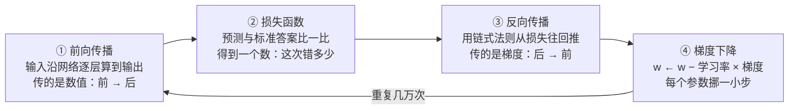

#AI #ML #deep-learning #training

# 神经网络的训练过程

> 前向传播、反向传播、梯度下降——这三个词最大的坑是它们**不是并列的三个步骤，甚至不是同一类东西**

> [!note] 定位
> **这篇讲**：训练的四个环节——前向传播、损失、反向传播、梯度下降——各自在干什么、怎么分工、怎么循环，以及训练与推理的分界。
> **这篇不讲**：神经网络本身长什么样、一次前向计算怎么走（去 [[神经网络]]）；求导与梯度的数学（去 [[导数、偏导与链式法则]]，第 5 节的演算依赖它）；梯度下降为什么那样更新（去 [[机器学习基础概念]] 第 7 节）；这套循环放到几十亿参数上（去 [[大模型如何训练]]）。
> **前置**：[[神经网络]]、[[导数、偏导与链式法则]]。

## TL;DR

- **只有两个阶段**：训练（找参数）和推理（用参数）。推理**只走前向传播**一步
- **四个词分属四个类别**：前向传播是计算过程，损失函数是打分函数，反向传播是求导算法，梯度下降是更新规则
- **反向传播 ≠ 梯度下降**，这是最常见的误解。**反向传播一个参数都不改**，它只算出「每个参数该往哪边动、影响多大」；动手改的是梯度下降
- 需要的数学只有三样：**偏导数、梯度、链式法则**，都在 [[导数、偏导与链式法则]] 里
- **反向传播的全部价值是「快」**：笨办法要为每个参数各跑一次前向（70 亿参数 = 一步训练跑 70 亿次前向），反向传播一次回推就全部算完，代价约等于两次前向
- **训练一次 = ①前向 → ②算损失 → ③反向 → ④更新**，循环几万到几百万次
- 推理没有 ②③④ ——这就是为什么模型**不会从和你的聊天里学到任何东西**

---

## 1. 先把类别分清

| 名字 | 它是什么 | 吃什么 | 吐什么 |
|---|---|---|---|
| **前向传播** Forward Propagation | 一个**计算过程** | 输入 + 当前参数 | 预测结果 |
| **损失函数** Loss Function | 一个**打分函数** | 预测 + 标准答案 | 一个数（标量） |
| **反向传播** Backpropagation | 一个**求导算法** | 损失 + 前向缓存的中间值 | 每个参数的梯度 |
| **梯度下降** Gradient Descent | 一个**更新规则** | 梯度 + 学习率 | 一批新参数 |

把它们当成「三个并列步骤」就会处处别扭。正确的读法是：**前向和反向是两趟遍历，损失是中间那个转折点，梯度下降是最后动手的那一下。**

---

## 2. 一次训练循环



**「学习」「训练」这两个词指的就是这整个循环**，没有别的含义：在这个过程中，通过梯度下降的手段，让参数逐步从随机数调整到可用状态。

---

## 3. ① 前向传播

名字直白：**数值从输入层往输出层「传」过去**。做的事就是 [[神经网络]] 那个公式逐层套娃：

$$\mathbf{a}^{(l)} = \sigma\!\left(\mathbf{W}^{(l)} \mathbf{a}^{(l-1)} + \mathbf{b}^{(l)}\right)$$

从第 1 层算到第 L 层，最后一层的输出就是预测值。记号的完整解释见 [[神经网络]] 第 2 节。

一个训练时才有的细节：**每一层的中间结果 $\mathbf{a}^{(1)}, \mathbf{a}^{(2)}, \dots$ 必须缓存下来**，因为第 ③ 步的链式法则要用到它们。

```text
推理：算完第 l 层，第 l−1 层的结果就可以扔掉  → 显存只需装下一两层
训练：所有层的中间结果都要留到反向传播用完   → 显存随层数线性增长
```

这是训练比推理吃显存得多的主要原因之一（另一个是优化器状态，见 [[微调与 LoRA]]）。

---

## 4. ② 损失

拿预测 $\hat{y}$ 和标准答案 $y$ 比，得到**一个标量**。回归任务最常见的是均方误差：

$$L = \frac{1}{m}\sum_{i=1}^{m}\left(y_i - \hat{y}_i\right)^2$$

其中 $m$ 是这一批样本的数量——**损失是一批样本的平均，不是单条样本的**。

**为什么必须压缩成一个数**：梯度下降要「下山」，而山必须只有一个高度值，否则「往下」这个方向没有定义。分类任务用交叉熵，损失函数的选择与推导见 [[机器学习基础概念]] 第 5 节。

---

## 5. ③ 反向传播

### 它要解决的问题

损失是一个数，参数有 70 亿个。**你怎么知道其中第 3,000,000,001 个权重该调大还是调小？**

**笨办法**：把那个权重加一点点，重跑一次前向传播，看损失变大还是变小。对每个参数都这么试一遍——**一步训练要跑 70 亿次前向传播**。彻底不可行。

### 反向传播的做法

从损失出发，用**链式法则**一层层往回推。关键在于回推时**上游算出的结果可以直接复用给下游**，不必每个参数从头算一遍。于是从后往前遍历一次，所有参数的偏导数就全部出来了。

```text
一次前向传播      代价记作 1
一次反向传播      代价约 2
一步完整训练      约 3 倍于一次推理
```

对比笨办法的 70 亿倍，这就是它的全部意义。

### 一次完整演算（两个权重，可以手算完）

最小网络：输入 $x=2$，第 1 层权重 $w_1=3$，过 ReLU，第 2 层权重 $w_2=4$，标准答案 $y=10$，损失用平方误差。偏置都取 0。

**先前向一遍**：

```text
z₁ = w₁ · x   = 3 × 2 = 6
a₁ = ReLU(6)  = 6
ŷ  = w₂ · a₁  = 4 × 6 = 24
L  = (ŷ − y)² = (24 − 10)² = 196
```

**再反着乘回去**。每一步都只是「上游传来的数 × 本地的一个偏导」：

| 顺序 | 经过 | 本地偏导 | 计算 | 得到 |
|---|---|---|---|---|
| ① | 损失函数 | $\partial L/\partial \hat{y} = 2(\hat{y}-y)$ | $2 \times 14$ | $\partial L/\partial \hat{y} = 28$ |
| ② | $\times w_2$，对 $w_2$ | $\partial \hat{y}/\partial w_2 = a_1 = 6$ | $28 \times 6$ | $\partial L/\partial w_2 = \mathbf{168}$ ← 要的梯度 |
| ② | $\times w_2$，对 $a_1$ | $\partial \hat{y}/\partial a_1 = w_2 = 4$ | $28 \times 4$ | $\partial L/\partial a_1 = 112$ ← 往前传 |
| ③ | ReLU | $\mathrm{ReLU}'(6) = 1$ | $112 \times 1$ | $\partial L/\partial z_1 = 112$ |
| ④ | $\times w_1$，对 $w_1$ | $\partial z_1/\partial w_1 = x = 2$ | $112 \times 2$ | $\partial L/\partial w_1 = \mathbf{224}$ ← 要的梯度 |

**硬算验证一遍**（这是最值得亲手做一次的一步）：

```text
把 w₁ 从 3 改成 3.001，重跑整个前向：
  z₁ = 6.002 → a₁ = 6.002 → ŷ = 24.008 → L = 14.008² = 196.224064

ΔL / Δw₁ = 0.224064 / 0.001 ≈ 224      ✓ 与链式法则算出的一致
```

**最后交给梯度下降**（学习率取 0.001）：

```text
w₂ ← 4 − 0.001 × 168 = 3.832
w₁ ← 3 − 0.001 × 224 = 2.776

重跑前向：z₁ = 5.552 → a₁ = 5.552 → ŷ ≈ 21.275
L 从 196 降到 (21.275 − 10)² ≈ 127.1        ✓ 一步就见效
```

这就是一个完整的训练 step。几十层、几十亿参数的网络做的是同一件事，只是这张表长很多。

### 每层只做两件事

上面第 ② 步是整个算法的模板，每一层都照它来：

```text
拿到上游传来的 ∂L/∂z（本层输出的灵敏度）之后：
  1. × 本层的输入   → 本层权重的梯度       （存起来给梯度下降用）
  2. × 本层的权重   → 传给前一层的 ∂L/∂a   （继续往前传）
```

**复用就在第 2 条**：算 $\partial L/\partial w_1$ 时直接用了上一步的 112，而 112 又来自 28。这个「往前传的数」是**所有更靠前的参数共用的前缀**，算一次就够。

而笨办法为什么慢，现在也清楚了：为了量 $\partial L/\partial w_1$，必须把 $z_1 \to a_1 \to \hat{y} \to L$ 整条链**重算一遍**；每个参数都要重算一次全网络。反向传播把共用前缀只算一次，一趟走完全部参数。

### 三个必须记住的点

- **反向传播不是一种学习方法，它只是一个高效求导的算法。** 1986 年这个算法被推广开，深层网络才第一次训得动
- **它一个参数都不改**，只产出梯度这份「体检报告」
- **梯度**是所有偏导数 $\partial L / \partial w$ 排成的一个向量。7B 模型的梯度就是一个 70 亿维的向量，和参数一一对应

### 名字的对称

```text
前向传播：传的是数值      输入 → 输出
反向传播：传的是「责任」   输出 → 输入
```

每个参数对这次错误负多少责任，从输出层倒着分摊回输入层——这就是「反向传播」四个字的字面意思。

---

## 6. ④ 梯度下降

拿到梯度之后，规则只有一行：

$$w \leftarrow w - \eta \cdot \frac{\partial L}{\partial w}$$

- **梯度指向损失上升最快的方向**，所以前面是**减号**——往反方向走才是下山。教科书定义：沿函数在当前点处最速下降方向（负梯度方向）移动，使函数值逐步减少
- $\eta$ 是**学习率**，即每一步迈多大。这是唯一必须由人来定的旋钮：太大会跨过谷底来回震荡甚至发散，太小则训到天荒地老
- **全部参数在这一步同时更新**，不是一个一个来

数学细节（导数为什么指方向、学习率怎么取）见 [[机器学习基础概念]] 第 7 节。

### 常见变体不是替代品

SGD、Momentum、Adam、AdamW 全都是在这一行上做改良，内核仍是「按梯度反方向挪」：

| 变体 | 改了什么 |
|---|---|
| **Momentum** 动量 | 累积历史梯度方向，减少震荡、冲过小坑 |
| **Adam / AdamW** | 动量 + 每个参数各自的自适应步长；大模型训练的默认选择 |

**Adam 不是梯度下降的替代品，是它的改良版。**

---

## 7. 三种训练模式：一次用多少样本

第 4 节说损失是「一批样本的平均」——这一批取多大，就是训练模式的分界：

| 模式 | 每步用多少样本 | 特点 |
|---|---|---|
| **随机梯度下降**<br/>Stochastic GD (SGD) | 1 条 | 梯度噪声极大、收敛震荡；早年小数据集用，现代大模型基本不用 |
| **全批量梯度下降**<br/>Full Batch GD | 全部训练集 | 梯度方向最稳定；但大数据集显存爆炸、迭代极慢，不用于大模型 |
| **小批量梯度下降**<br/>Mini-Batch GD | 固定数量（32 / 128 / 1024…） | **平衡稳定性与速度，显存可控——LLM 与 CV 模型的默认选择** |

这个「固定数量」就是超参数 **batch size**。

> 术语提醒：现在文献和代码里说的 "SGD"（如 PyTorch 的 `torch.optim.SGD`）几乎都指 mini-batch 版本，严格意义上「每步 1 条样本」的原始 SGD 已经没人用了。看到 SGD 默认理解成小批量即可。

配套的三个计量单位：

| 名词 | 含义 |
|---|---|
| **batch / mini-batch** | 一次拿多少条样本算一次损失、更新一次参数 |
| **step / iteration** | 完整走一遍 ①②③④ 叫一步 |
| **epoch** | 整个训练集被完整过了一遍（= 训练集大小 ÷ batch size 步） |

---

## 8. 推理阶段：只有前向传播

参数训练完就**冻结**了。你调用模型时发生的全部事情是：输入进来 → 前向传播 → 输出结果。**没有损失、没有反向传播、没有梯度下降。**

这解释了三件常被问到的事：

- **为什么训练贵、推理便宜**：训练要跑天文数字次「前向 + 反向」，一次推理只是一次前向
- **为什么模型不会从聊天里学到东西**：推理阶段根本没有改参数的环节。它「记住」上文靠的是把历史对话重新塞进输入，不是参数变了（见 [[大语言模型]]）
- **为什么微调需要单独一轮训练**：想让参数真的变，就必须重新走完整的 ①②③④（见 [[微调与 LoRA]]）

---

## 9. 用什么把这套循环跑起来

前向、反向、梯度下降这三步都不需要手写——深度学习框架的核心功能就是**自动微分**：你只写前向传播，框架自动构建计算图并推导出反向传播。

| 框架 | 现状 |
|---|---|
| **PyTorch** | 当前研究与训练的绝对主力，大模型生态默认 |
| **TensorFlow** | 已退出主流训练场景，主要留在部署与边缘计算（TF Lite） |
| **JAX** | 少数超大规模训练在用，函数式风格 |

训练的产物是**模型文件**：核心权重文件占 99% 体积，另有配置文件记录网络架构、隐藏层维度、权重精度等。文件构成与格式见 [[模型里的四类数字]]。

---

## 相关文章

- [[导数、偏导与链式法则]] - 本文第 5、6 节用到的全部微积分：灵敏度读法、四条求导公式、梯度、链式法则，附自测题
- [[神经网络]] - 前向传播的每一层具体在算什么：加权求和 + 偏置 + 激活函数
- [[机器学习基础概念]] - 第 5 节损失函数怎么选、第 7 节梯度下降的数学直觉
- [[大模型如何训练]] - 这套循环放到几十亿参数上：题库自造、概率表、亿万个旋钮
- [[模型里的四类数字]] - 训练动的是「参数」，不动的是「超参数」，两者的分界
- [[微调与 LoRA]] - 只对一部分参数重跑这个循环
- [[大语言模型]] - 推理阶段的完整形态
- [[AI/Map|AI 知识地图]] - 一次推理调用（只有前向传播）的逐步拆解

---

## 参考资料

- 《Agents 底层逻辑》第 4 章 前向传播、第 5 章 梯度下降、第 6 章 训练模式和框架（袁进）
- 《动手学深度学习》第一章 - 引言
