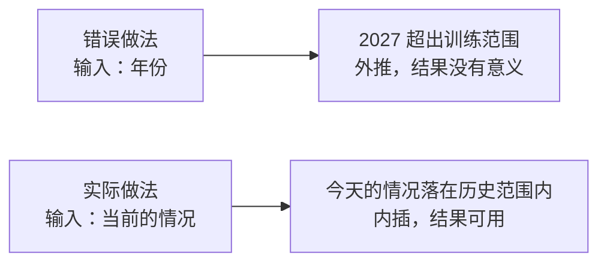

#AI #ML #neural-network #generalization

# 神经网络的适用范围

> [!note] 定位
> **这篇讲**：神经网络和「写出公式」两种做法各适合什么问题；为什么它在训练数据范围内可靠、范围外不可靠；没有未来的数据，怎么还能预测未来。
> **这篇不讲**：网络内部怎么算出一个数、折点怎么来（去 [[神经网络]]）；参数怎么训练出来（去 [[神经网络的训练过程]]）；过拟合（去 [[机器学习基础概念]]）。
> **前置**：[[神经网络]] 的第 4 节（ReLU 折点、$n$ 个折点切出 $n+1$ 段直线）和第 6 节（万能逼近定理）。

## TL;DR

- 写公式需要先弄清规律；神经网络不需要，只要数据。代价是：它只给出**近似值**，**不告诉你规律是什么**
- ReLU 网络是一条折线。在训练数据**之间**取值叫**内插**，结果可靠；在训练数据**之外**取值叫**外推**，结果没有意义
- 外推失败不是训练没做好：最外侧的折点之后只剩一条直线，网络没有任何依据知道曲线后面怎么弯
- 网络不会提示「这个输入我没见过」，对任何输入都照样输出一个数。所以要靠数据覆盖将来的使用范围，并在系统里另外检查输入是否超出范围
- 预测未来的做法是**不把时间当输入**，而是输入「当前的情况」、输出「下一期的结果」。今天的情况多半落在历史出现过的范围里，问题就从外推变成了内插
- 这种转换的前提是过去的规律在未来依然成立。遇到前所未见的情况、预测得太远、规律本身发生变化时，预测会失灵
- 规律已知、公式写得出的问题，直接用公式更好；神经网络的价值在于房价、图像、语言这类写不出公式的问题

---

## 1. 写公式 vs 训练网络：拿自由落体试一次

科学家研究一种现象，通常要先找出一个专门的公式，比如物体下落的距离：

$$s = \frac{1}{2}gt^2$$

写出它的前提是已经弄清了背后的规律。房价、图像识别这类问题，规律复杂到人写不出公式，神经网络换了做法：用同一种零件（加权求和 + 偏置 + ReLU）拼出一个函数，参数从数据里调出来。

那么规律已知的问题，神经网络也能做吗？取 $g \approx 10$，即 $s = 5t^2$，0 到 4 秒的真实数据是：

| $t$（秒） | 0 | 1 | 2 | 3 | 4 |
|---|---|---|---|---|---|
| $s$（米） | 0 | 5 | 20 | 45 | 80 |

[[神经网络]] 第 4 节讲过，一层 ReLU 网络是一条折线，$n$ 个折点切出 $n+1$ 段直线。假设训练得很理想，折点恰好落在 1、2、3 秒，4 段直线把这 5 个点依次连起来。四段的斜率分别是：

```text
(5−0)/1 = 5    (20−5)/1 = 15    (45−20)/1 = 25    (80−45)/1 = 35
```

在两个数据点**中间**检查一次，比如 $t = 1.5$：

```text
真实值：5 × 1.5² = 11.25
折线值：1 秒和 2 秒连线的中点 = (5 + 20) / 2 = 12.5
误差：1.25 米
```

折点越多，每段越短，折线越贴近曲线，误差越小。这就是万能逼近定理说的「任意精度」。训练时不需要告诉网络公式，只要给它足够多的 (时间, 距离) 数据对。

但和公式比，它有三点做不到：

| | 写出公式 | 训练神经网络 |
|---|---|---|
| 需要先弄清规律吗 | 需要 | 不需要，只要数据 |
| 精度 | 精确 | 近似，总有一点误差 |
| 数据范围之外 | 照样准确 | 不可靠（第 2 节） |
| 能读出规律吗 | 能，公式本身就是规律 | 不能，学到的只是一堆权重和偏置的数值，看不出里面有 $\frac{1}{2}gt^2$ |

**结论**：规律已知的问题直接用公式。神经网络适合的是写不出公式的问题，在那里近似值也比没有强得多。

## 2. 内插可靠，外推不可靠

两个术语：

- **内插**（interpolation）：在已知数据点**之间**估计取值。上一节 $t=1.5$ 就是内插
- **外推**（extrapolation）：在已知数据点**之外**估计取值

还是只用 0 到 4 秒的数据训练，然后问 6 秒落了多远：

```text
真实值：5 × 6² = 180 米
折线值：4 秒之后没有折点，最后一段按斜率 35 继续延伸
        80 + 35 × (6 − 4) = 150 米
误差：30 米
```

而且时间越往后误差越大：真实曲线的斜率一直在变大，折线的最后一段却是一条斜率固定的直线。

这不是训练没做好。网络的形状完全由折点决定，而折点只会落在有数据的地方，最外侧折点之外，它没有任何依据知道曲线后面怎么弯，只能直线延伸。公式之所以对任何 $t$ 都准，是因为它描述的是**规律本身**；网络学到的只是数据覆盖的那一段的**形状**。所以范围外算出的 150 米没有意义，不能拿来用。

内插的结果则是有价值的：训练数据只有 5 个点，网络却能给出 0 到 4 秒内任意时刻的估计。房价预测也一样，训练数据里不会恰好有你这套房子，但只要有很多面积、地段相近的房子，它就能给出靠谱的估价。

**更麻烦的是，网络自己不知道哪些输入在范围外。** 它对任何输入都照样算出一个数，看起来和内插的结果没有区别。实际使用时有三种应对：

1. **让数据覆盖将来的使用范围**。要预测 0 到 10 秒，就收集 0 到 10 秒的数据。大语言模型用几乎整个互联网的文字训练，也是为了让日常的问题大多落在见过的范围里
2. **只在范围内信任它**
3. **在系统里另外检查输入**：输入明显超出训练数据的范围时，不采用结果，或交给人判断

大语言模型的**幻觉**（hallucination，模型生成看似合理但与事实不符的内容，见 [[大语言模型]]）与此有关：问到训练数据里很少出现的内容时，它依然会流畅地生成回答，看起来和可靠的回答没有区别。这只是幻觉的原因之一。

## 3. 预测未来：把「时间」换成「当前的情况」

未来还没发生，自然没有数据。如果把函数定成「输入年份 → 输出房价」，用 2010 到 2025 年训练，再问 2027 年，那就和上一节的 6 秒一样，是外推，结果没有意义。

实际的做法是**不把时间当输入**，改成：

> 输入：这个月的均价、利率、成交量、新房供应量……
> 输出：下个月的均价

训练数据从历史中取，每个月都能组成一条「当时的情况 → 一个月后的实际结果」（下表数字为示意）：

| 当时的情况（输入） | 一个月后的均价（答案） |
|---|---|
| 某年 3 月：均价 3.0 万，利率 4.9%，成交 8000 套 | 4 月：3.05 万 |
| 某年 4 月：均价 3.05 万，利率 4.9%，成交 8200 套 | 5 月：3.1 万 |
| …… | …… |

十几年的历史可以组成一百多条这样的数据。预测时输入的是**今天的情况**，而今天的均价、利率、成交量，多半落在历史上出现过的范围里。对网络来说，这是内插，不是外推。它学到的是：过去遇到类似情况时，一个月后通常会怎样。

**未来没有数据，但「这种情况之后通常会发生什么」，历史上有数据。** 预测未来靠的就是这个转换。天气预报、销量预测都是同一个思路。



这个转换依赖一个前提：**过去的规律在未来依然成立**。以下三种情况会打破它：

| 情况 | 为什么失灵 |
|---|---|
| 出现前所未见的情况（疫情、突发的重大政策、利率低于历史最低点） | 今天的情况本身落在范围外，又回到了外推 |
| 预测得太远 | 预测 5 年后，要把「下个月」一步步往后推，每一步的误差都会累积到下一步 |
| 规律本身变了（购房观念、人口结构改变） | 历史数据描述的是旧规律，内插再准也只是准确地重复过去 |

所以房价、股价、天气这类预测，短期比较可靠，越往后越不准，遇到前所未见的事件时会失灵。这是「用过去推断未来」这种做法本身的局限，换更大的网络也解决不了。

---

## 自测

都能在纸上算完，答案在下方。

1. 用第 1 节的折线，算 $t = 2.5$ 时的折线值和真实值，误差是多少？
2. 同一条折线，$t = 5$ 时折线值是多少？真实值呢？这是内插还是外推？
3. 如果训练数据是 0 到 8 秒，问 6 秒，还是第 2 题那种情况吗？为什么？
4. 某人用「输入日期 → 输出气温」训练了一个网络，用来预测明年的气温。问题出在哪？怎么改？
5. 改成「输入今天的气温、气压、湿度 → 输出明天的气温」之后，哪种情况下它仍会失灵？举一个例子。

<br/>

> [!success]- 答案
> 1. 2 秒与 3 秒连线的中点：$(20+45)/2 = 32.5$；真实值 $5 \times 2.5^2 = 31.25$；误差 **1.25 米**。
> 2. 折线值 $80 + 35 \times 1 = \mathbf{115}$；真实值 $5 \times 25 = \mathbf{125}$；在最后一个数据点 4 秒之外，是**外推**。
> 3. 不是。6 秒落在 0 到 8 秒之间，是**内插**，结果可靠。同一个输入是内插还是外推，取决于训练数据覆盖到哪里。
> 4. 明年的日期不在训练数据范围内，是外推。改成输入「当前的情况」（今天的气温、气压、湿度等）、输出「下一期的结果」（明天的气温），让输入落在历史范围内。
> 5. 遇到历史上没出现过的情况时会失灵，例如有记录以来最强的寒潮：今天的读数超出了历史范围，又变成外推。另外两种情况也算对：预测得太远（如预测 30 天后）误差会累积；气候规律长期变化后，旧数据描述的是旧规律。

---

## 相关文章

- [[神经网络]] - 折线从哪来：ReLU 折点、$n+1$ 段直线、万能逼近定理
- [[神经网络的训练过程]] - 参数怎么从数据中调出来
- [[机器学习基础概念]] - 训练集与测试集、过拟合：另一种「训练时好、用时差」的情况
- [[大语言模型]] - 幻觉
- [[人工智能的分类]] - 写规则（符号主义）与从数据学（连接主义）两条路线的对比
