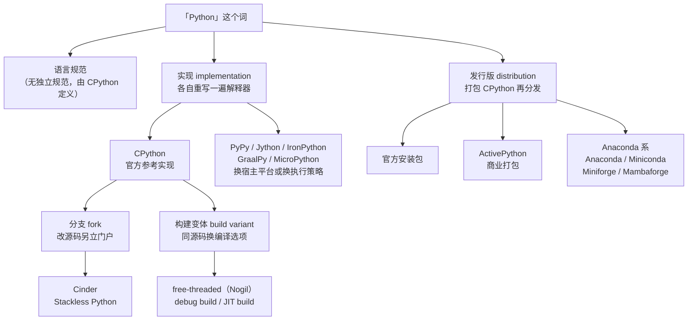

#Python #解释器 #发行版 #CPython #PyPy #选型

# Python 发行版与解释器实现

## TL;DR

「装 Python」这件事的选项多到反常识——CPython、Anaconda、Miniforge、PyPy、Nogil、Jython……这些名字**不在同一个维度上**，混在一张列表里看必然乱。它们其实分属四层：

| 层 | 是什么 | 例子 |
|---|---|---|
| **实现** | 谁重写了一遍解释器 | CPython、PyPy、Jython、IronPython、GraalPy、MicroPython |
| **分支** | 从 CPython 源码叉出去改的 | Cinder、Stackless Python |
| **构建变体** | 同一份 CPython 源码换编译选项 | free-threaded（Nogil）、debug build、JIT build |
| **发行版** | 谁把 CPython 打包成安装包分发 | 官方安装包、ActivePython、Anaconda / Miniconda / Miniforge |

**结论先给**：Agent 开发只用**官方 CPython**，用 [[0.05 uv\|uv]] 或 pyenv 装。其余选项各自对应一个很窄的场景，绝大多数人一辈子碰不到；唯一例外是需要 ffmpeg / gcc / CUDA 工具链这类非 Python 依赖时走 Anaconda 系（见 [[0.01 环境管理]] 第 4 节）。

---

## 1. 一个 Python 安装包里有什么

从官网下载的安装包不只是一个 `python` 可执行文件，它是四样东西的集合：

| 组件 | 是什么 | 典型入口 |
|---|---|---|
| **解释器** | 读源码并执行的程序，默认实现是 CPython | `python` |
| **包管理器** | 装第三方库的工具，随安装包附带 | `pip` |
| **标准库** | 装完就能 `import` 的内置模块 | `os`、`sys`、`json`、`pathlib`、`urllib` |
| **REPL** | 交互式终端（Read-Eval-Print Loop） | 直接敲 `python` 不带参数 |

**REPL**（Read-Eval-Print Loop，读取-求值-打印-循环）就是那个带 `>>>` 提示符的交互环境，敲一行执行一行，用来验证语法和试探 API：

```text
$ python
Python 3.14.1 (main, ...) on darwin
>>> 1 + 2
3
>>> exit()
```

Python 3.13 起 REPL 换成了新实现（PyREPL），支持多行编辑、历史翻阅、彩色报错、`exit` 不用加括号——之前这些体验要装 IPython 才有。

标准库的完整清单见官方文档，本库整理过的部分集中在 [[Python 教程总览]] 第 2.7 节。

---

## 2. 四层分类



分清这四层的价值在于：**换实现会换掉整个 C 扩展生态，换发行版只是换了装包方式**。前者是伤筋动骨的决定，后者随时可以改。

---

## 3. 实现层：各自重写的解释器

Python 语言没有像 JS 的 ECMAScript 那样的独立规范文档，**CPython 的行为就是规范**。其他实现都是在追着 CPython 兼容。

| 实现 | 跑在哪 | 卖点 | 现状与代价 |
|---|---|---|---|
| **CPython** | 原生机器码 | 官方参考实现，生态 100% 兼容 | 带 GIL，纯 Python 代码慢。**事实上的唯一选择** |
| **PyPy** | 原生机器码 | Tracing JIT，纯 Python 代码快 4-10 倍 | C 扩展兼容性一般，NumPy 系吃不到加速甚至更慢 |
| **Jython** | JVM | 能直接调 Java 类库，无 GIL | **长期停在 Python 2.7**，Jython 3 至今未正式发布，新项目不可用 |
| **IronPython** | .NET CLR | 能直接调 C# / .NET 库 | 语法支持落后官方多个版本，仅适合 .NET 集成场景 |
| **GraalPy** | GraalVM | 强 JIT，可与 Java 等多语言互操作 | 对齐版本滞后，C 扩展靠兼容层，生态覆盖不全 |
| **MicroPython** | 单片机 / 嵌入式 | 体积和内存占用极小 | 标准库大幅裁剪，是**语言子集**，不是完整 Python |

**为什么 CPython 再慢也换不掉**：NumPy、PyTorch、Pandas 这些库的性能核心是 C 代码，通过 CPython 的 C API（`Python.h`）直接操作解释器的内部结构。换个实现，内存布局就不一样了，这些扩展直接失效。整个 AI 生态都焊在 CPython 上。这条链路的细节见 [[5.15 CPython 解释器原理]] 第 6 节。

> 判断标准很简单：**你的依赖里只要有一个 C 扩展库（numpy、pydantic-core、orjson、任何 AI 库），就只能用 CPython。**

---

## 4. 分支层：从 CPython 叉出去改

分支不是新实现，是**拿 CPython 源码改完自己编译**，所以它们大体兼容 C 扩展，但跟不上官方版本节奏。

- **Cinder** —— Meta 自研的 CPython 分支，针对 Instagram 那种长驻服务做运行时和 GC 优化，另外带 Static Python、Strict Modules 等实验特性。代码开源，但官方明确说它是「为 Meta 内部工作负载调优的」，不面向通用生产使用。它的一部分优化成果后来被上游 CPython 吸收了。
- **Stackless Python** —— CPython 分支，自研无栈微线程（tasklet + channel），把协程做在解释器层面，历史上给《EVE Online》这类高并发游戏服务用。现在 Python 有了原生 `asyncio`，它的位置已经被取代；但从它剥离出来的 `greenlet` 库仍然活着，gevent、SQLAlchemy 的部分异步桥接都在用。

---

## 5. 构建变体层：同一份源码，不同编译选项

这一层最容易被误当成「另一个 Python」，其实**源码和官方完全一样，只是 `configure` 时开了别的选项**。

### 5.1 free-threaded（俗称 Nogil）

去掉 GIL（全局解释器锁）的官方构建，出自 PEP 703。GIL 是一把保护解释器内部状态的大锁，它导致 Python 多线程无法真正并行执行 CPU 密集代码——这条约束和它的来龙去脉见 [[5.15 CPython 解释器原理]] 第 5 节、[[4.03 并发编程]]。

关键点：

- 从 **Python 3.13 起，free-threaded 是官方支持的可选构建**，不是第三方项目。可执行文件带 `t` 后缀（`python3.13t`），和普通构建可以并存
- 它是**编译期决定**的，装的时候就要选，不能运行时切换
- 代价：单线程性能有回退（早期版本约 10-40%，后续版本在收窄），且**C 扩展必须显式声明支持自由线程**，否则会退回到启用 GIL 的模式
- 3.14 继续推进（性能回退大幅改善、更多库适配），但默认构建仍然带 GIL

装法上，uv 和 pyenv 都支持带后缀的版本号：

```shell
uv python install 3.14t
pyenv install 3.14.1t
```

### 5.2 其他常见变体

| 变体 | 编译选项 | 用途 |
|---|---|---|
| debug build | `--with-pydebug` | 带断言和额外检查，开发 CPython 本身或调试 C 扩展时用 |
| JIT build | `--enable-experimental-jit` | 3.13 起的实验性 JIT（copy-and-patch），默认关闭 |
| 优化构建 | `--enable-optimizations`（PGO+LTO） | 官方发布用的，比默认构建快 10-30% |

pyenv 的存在价值主要就在这一层：**它是现场编译的，所以能传任意 `configure` 参数**。uv 只能装 python-build-standalone 提供的现成构建（见 [[0.05 uv]] 第 4.4 节）。

---

## 6. 发行版层：谁来打包分发

这一层跑的**都是 CPython**，区别只在「安装包里预装了什么、用哪个包管理器、包从哪个仓库下载」。

| 发行版 | 装了什么 | 包管理器 | 定位 |
|---|---|---|---|
| **官方安装包** | CPython + pip + 标准库 | pip | 默认首选，最干净 |
| **ActivePython** | CPython + 预装常用依赖 | pip（+ 商业工具链） | ActiveState 的商业打包，卖的是企业级支持和合规审计 |
| **Anaconda** | CPython + conda + 几百个数据科学库 | conda | 开箱即用，几个 GB |
| **Miniconda** | CPython + conda | conda | Anaconda 精简版，只留内核 |
| **Miniforge** | CPython + conda（+ mamba） | conda / mamba | 社区维护，**默认走 conda-forge 频道**，规避 Anaconda 商业授权限制 |
| **Mambaforge** | Miniforge + mamba 作为默认求解器 | mamba | **已停止维护**——Miniforge 现在自带 mamba，官方建议直接用 Miniforge |

### 6.1 Miniforge 而不是 Miniconda

Anaconda 官方频道（`defaults`）的**授权条款要求较大规模的商业组织付费**，而 conda-forge 是社区频道、完全免费。Miniforge 的唯一改动就是把默认频道从 `defaults` 换成 `conda-forge`，所以它成了「想用 conda 但不想踩授权问题」的标准答案。

### 6.2 mamba 是什么

conda 最被诟病的是依赖求解慢（几分钟不夸张）。**mamba 是 conda 的 C++ 重写版求解器**，命令完全兼容（`mamba install` 换掉 `conda install`），快一个数量级。现在 conda 自身也换用了同一套求解算法（`libmamba`），差距已经不像当年那么大。

Anaconda 系的完整用法、和 pip 混用的风险、磁盘占用机制，见 [[0.01 环境管理]] 第 4 节和第 7 节。

---

## 7. 怎么选

### 7.1 决策表

| 场景 | 选什么 | 理由 |
|---|---|---|
| **Agent / 后端 / 日常开发** | 官方 CPython，用 [[0.05 uv\|uv]] 装 | 生态 100% 兼容，装得快，锁文件齐 |
| 要装 ffmpeg / gcc / cmake / R | Miniforge | 只有 conda 能装非 Python 程序 |
| 要自定义编译选项的解释器 | pyenv 编译官方源码 | 只有它是现场编译 |
| 要试自由线程多核并行 | `3.14t` 构建变体 | 官方支持的可选构建 |
| 纯 Python 计算密集、无 C 扩展 | PyPy | JIT 能给 4-10 倍，但这个前提极少成立 |
| 要嵌进 JVM / .NET 现有系统 | Jython / IronPython | 唯一选项，但要接受版本严重落后 |
| 单片机、IoT 设备 | MicroPython | 唯一选项 |
| 企业合规要求商业支持 | ActivePython | 买的是支持合同，不是技术 |

### 7.2 一句话总览

**先默认官方 CPython，只有当出现一个具体到你能说出名字的阻塞点时，才去换。** 这个列表里 90% 的选项存在的意义是让你知道「它不适合我」，而不是让你去挑。

---

## 参考资料

- [[0.01 环境管理]] —— 装好之后怎么管多版本、多环境：pyenv / conda / uv 三条路线
- [[0.05 uv]] —— 推荐的安装与管理工具，覆盖解释器、环境、依赖、锁文件
- [[5.15 CPython 解释器原理]] —— CPython 内部：字节码、GIL、C 扩展 API 为什么锁死了生态
- [[4.03 并发编程]] —— GIL 对多线程的实际影响，以及线程/进程/协程怎么选
- [[0.03 解释型语言与代码发布]] —— 「解释执行」到底意味着什么
- [[0.07 编辑器与运行方式]] —— 装完之后：怎么把代码跑起来
- Python 官方下载 https://www.python.org/downloads/
- PEP 703（free-threaded CPython） https://peps.python.org/pep-0703/
- Miniforge https://github.com/conda-forge/miniforge
