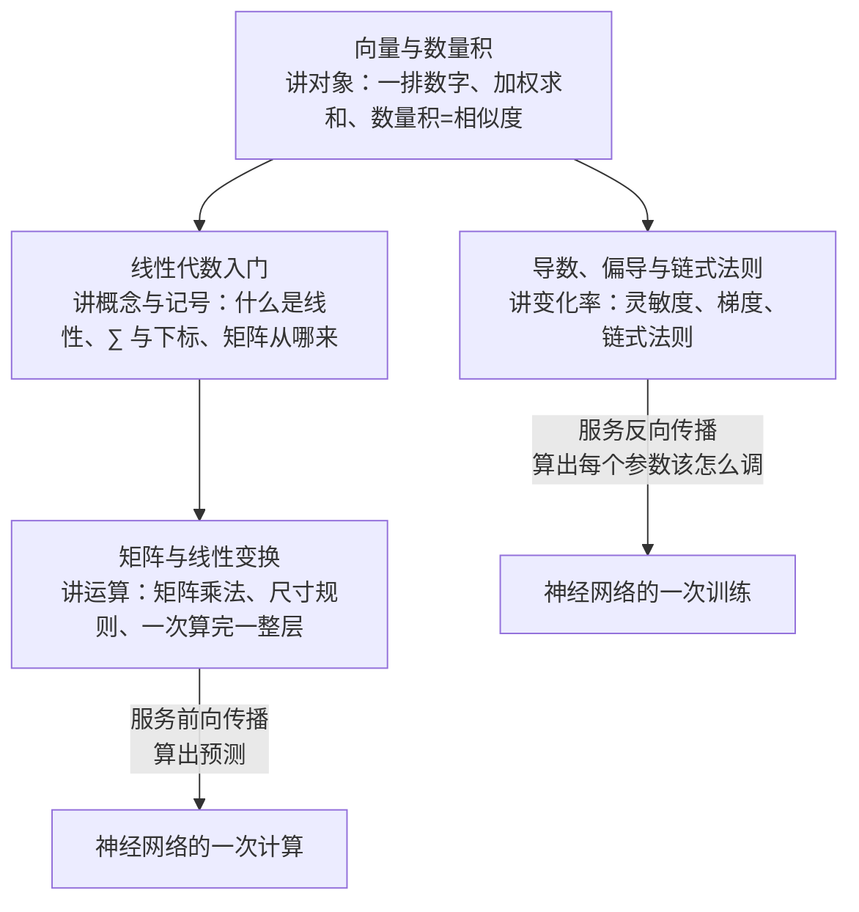

#math #index

# 数学地基索引

> 读 AI 笔记时用得到的那部分数学，四篇，按需查。不是数学课程——**只收在 [[AI/Index|AI 知识索引]] 里真的会被用到的概念**，用不到的一律不写

## 这四篇怎么分工

分界线是**前向传播用什么、反向传播用什么**：

| 篇 | 一句话 | 前置 | 服务于 |
|---|---|---|---|
| [[向量与数量积]] | AI 的通用语言：一排数字与相似度 | 无 | 全部 |
| [[线性代数入门]] | 什么是线性、矩阵从哪来、数学符号怎么读 | 向量与数量积 | 前向传播 |
| [[矩阵与线性变换]] | 一次算完一整层的语言 | 前两篇 | 前向传播 |
| [[导数、偏导与链式法则]] | 反向传播用到的全部微积分，附自测题 | 向量与数量积（梯度是向量） | 反向传播 |

**[[线性代数入门]] 是零基础入口**：看不懂 $\sum$、下标、$f(u+v)$ 这类记号就从它开始。
**[[导数、偏导与链式法则]] 只需要初中代数**：全篇结论都能用「把变量加 0.001、重算一遍、看比率」自行验证，文末有六道带答案的自测题。

---

## 概念速查

| 概念 | 所在笔记 |
|---|---|
| 向量、一排数字与一支箭、模、加权求和、数量积（俗称点积）、数量积的几何公式 $\|a\|\|b\|\cos\theta$、投影、余弦相似度、king−man+woman、维度与等长约束、数据形状；**附录**：向量空间八条公理、基与坐标、内积、Cauchy–Schwarz、自由向量、勾股定理、余弦定理证明、叉乘 | [[向量与数量积]] |
| 线性函数、可加性、齐次性、仿射、线性组合、基向量、张成、$\sum$ 求和符号、下标 | [[线性代数入门]] |
| 矩阵、Hadamard 积（逐元素乘）、数量积 / 向量积的规范名称与俗称对照、矩阵乘法、尺寸规则、转置、单位矩阵、逆矩阵、线性变换、批量计算 | [[矩阵与线性变换]] |
| 导数、灵敏度读法、求导公式、ReLU 的导数、dead ReLU、偏导数与 $\partial$、梯度 $\nabla L$、链式法则、梯度消失、梯度爆炸与裁剪 | [[导数、偏导与链式法则]] |

---

## 还没填的缺口

- **概率与对数**（$\log$、指数、概率分布、极大似然、softmax）—— [[机器学习基础概念]] 第 5 节已经在用交叉熵、softmax、极大似然、$\log$，但这里没有一篇讲它们的地基。是当前最该补的一篇
- **数值稳定性**（浮点误差在深度学习里的表现、为什么要 log-sum-exp）—— 与 [[浮点数精度]] 相邻，优先级低

---

## 维护说明

- 只在 AI 笔记真的用到某个数学概念、且它成了阅读障碍时才新增一篇；**不按数学教材的体系铺开**
- 本目录的四篇同时挂在 [[AI/Index|AI 知识索引]] 的知识树上（编号 ①~④）。**阅读顺序以那份索引为准**，本页只说明四篇之间的分工
- 文件名不加序号前缀，避免破坏既有双链
- 每篇都要能被「动一点点看变多少」或具体数值演算验证，避免只有定义和公式
